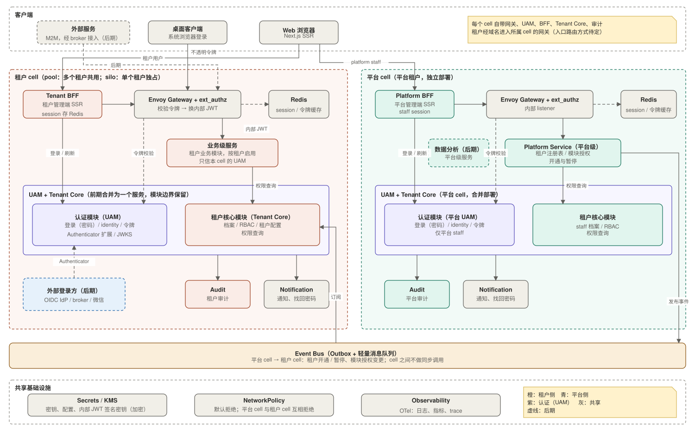

# 01 架构总览

状态：设计基线（尚未落地）。认证细节见 [02](02-authentication.md)，分层与调用规则见 [03](03-service-layering-and-trust.md)，多租户见 [04](04-multi-tenancy.md)，事件见 [05](05-events.md)，决策与待定项见 [06](06-decisions.md)。

## 1. 背景与目标

搭建一个小型的微服务 SaaS 平台：不同租户启用不同的业务模块，业务服务独立部署，平台侧与租户侧在数据和权限上严格隔离。

**约束**（已定）：

- 技术栈：后端 Java / Spring Boot，SSR 前端 Next.js，部署在 Kubernetes，网关使用 Envoy Gateway。
- 接入端：Web（SSR，非 SPA）、桌面端；外部服务后期接入。
- 身份：自研 UAM；第一阶段用户名密码，后期支持租户自带 OIDC IdP、broker（如 Keycloak）、微信，多种登录方式可关联到同一个用户。
- 边界：租户用户和租户内部数据对平台侧不可见；平台是特殊的“平台租户”，独立 cell 部署，与租户 cell 分库、分审计。
- 所有服务（包括 BFF）必须支持水平扩展。
- 前期规模：租户不超过 5 个，只保留边界，不提前做重的基础设施。

**设计目标**：

1. 每一跳都校验，不因为在内网就信任。
2. 终端只持有不透明令牌，网关换成短有效期的内部 JWT，各服务只做本地验签。
3. 先把边界定对；早期可以合并部署，后期再拆分。

## 2. 核心术语

| 术语 | 含义 |
|---|---|
| 租户 | 使用平台的客户组织 |
| 平台租户 | 特殊的保留租户，承载平台自己的模块（Platform Service、未来的数据分析等）；platform_staff 就是它的 tenant_user |
| cell | 一套独立部署单元（网关、服务、库、审计），不与其他 cell 共用。租户 cell 分 pool（多个租户共用）与 silo（单租户独占）；平台租户占独立的平台 cell |
| tenant_user | 租户内的用户，档案在所属 cell 的 Tenant Core |
| UAM | User Account Management，自研 Auth 服务，是 Tenant Core 的认证模块，每个 cell 一套 |
| 不透明令牌 / 内部 JWT | 终端持有的是 UAM 签发的不透明令牌；网关 ext_authz 把它换成短有效期的内部 JWT 转发，内部 JWT 不出集群，契约见 02 |
| BFF | Backend for Frontend，SSR 应用的服务端，持有用户 session |
| Outbox | 在业务事务内写 outbox 表，再异步发布事件，保证业务数据与事件一致 |

## 3. 总览图

- 平台 cell 与租户 cell 对等：各自带网关、BFF、Tenant Core（含 UAM）、审计，按四层组织；cell 之间不做同步调用，只通过 Event Bus 交互（D1、D28）。
- 终端只持有不透明令牌，BFF 不接触内部 JWT；staff 与租户用户走同一条换发路径（D25）。
- 租户经域名进入所属 cell 的网关，入口路由方式待定。
- 虚线是后期功能；外部登录方只与 UAM 对接，下游服务不关心用户怎么登录的。

## 4. 组件职责表

实现某个组件前，以本表为边界依据。“不负责”一栏同样是约束。分层与调用规则见 03。

### 4.1 入口层

| 组件 | 负责 | 不负责 | 主要依赖 |
|---|---|---|---|
| Envoy Gateway + ext_authz（每个 cell 一套） | TLS 终止、按路径路由到本 cell 的服务；ext_authz 校验不透明令牌并换发内部 JWT（见 02 第 5 节） | 业务授权、通用限流（前期不做）、签发令牌 | 本 cell UAM 的令牌数据、签名密钥（KMS 加密） |
| Tenant BFF | 租户管理端 SSR 与聚合；持有用户 session（HttpOnly cookie，session 存 Redis，内容是不透明令牌）；经 UAM 登录；通过网关调用租户侧；租户管理员管理用户时调用 UAM 的管理接口 | 校验业务权限、把令牌给浏览器、接触内部 JWT | UAM、网关、Redis |
| Platform BFF | 与 Tenant BFF 同一份代码，部署在平台 cell；持有 staff session；经平台 UAM 登录，经平台 cell 网关调用平台级服务 | 访问租户 cell、接触内部 JWT | 平台 UAM、网关、Redis |

### 4.2 业务服务层

平台级与业务级的区别见 03 第 1 节。

| 组件 | 负责 | 不负责 | 主要依赖 |
|---|---|---|---|
| Platform Service（平台级） | 租户注册表、模块授权（entitlement）、租户开通与暂停的发起；通过 Outbox 发布事件 | 租户用户与租户内部数据 | 自有数据库、Event Bus、平台 Tenant Core |
| 其他平台级服务（如数据分析） | 后期；数据来源与边界实现时再定 | 读取租户业务库 | 待定 |
| Business Services（业务级） | 各业务模块的领域逻辑；按 `tenant_id` 隔离数据；向 Tenant Core 查询角色并判断模块是否开通（短 TTL 缓存） | 登录、签发令牌、跨租户访问 | Tenant Core、各自数据库 |

### 4.3 核心域层：Tenant Core

每个 cell 一套，前期合并部署为一个服务，两个模块边界保留（D29、D30）：

| 模块 | 负责 | 不负责 | 主要依赖 |
|---|---|---|---|
| 认证模块（UAM） | 登录、用户与登录身份、凭证、不透明令牌的签发与吊销、内部 JWT 的 JWKS、`tenant_user_id` 的生成、管理接口、CLI 冷启动；细节见 02 | 业务授权、档案与 RBAC、租户注册 | 自有 schema、Notification |
| 租户核心模块 | tenant_user 档案（含平台 cell 的 platform_staff）、角色与 RBAC、租户配置；权限查询接口（角色、租户状态、已开通模块）；订阅平台 cell 的租户与授权事件，维护只读投影 | 登录凭证与令牌（归认证模块）、租户注册（归 Platform Service） | 自有 schema、Event Bus |

### 4.4 基础服务层

| 组件 | 负责 | 不负责 |
|---|---|---|
| Audit | 本 cell 的审计日志存储与查询；记录最初发起者与 trace id | 跨 cell 查询：平台侧看不到租户侧审计 |
| Notification | 通知发送（邮件、站内信等），含找回密码 | 业务决策 |

### 4.5 共享基础设施

| 组件 | 说明 |
|---|---|
| Event Bus | Postgres Outbox 加轻量消息队列，不上 Kafka（见 05） |
| Redis | BFF session、令牌查询缓存 |
| NetworkPolicy | 默认拒绝，服务间最小授权 |
| Secrets / KMS | 密钥与配置，内部 JWT 签名密钥加密保存 |
| Observability | 日志、指标、trace（OpenTelemetry） |

## 5. 前期取舍

以下不做，保持边界不变、需要时再加（触发条件见 [06](06-decisions.md) 第 2 节）：

- Service Mesh（用 NetworkPolicy 加每个服务验 token 代替）、通用限流（UAM 登录端点的失败锁定与限流除外）；
- broker、外部 IdP、JIT、微信、外部服务 M2M、API Key、on-behalf-of；
- 平台级数据分析服务；
- UAM 与租户核心模块、Platform Service 内部各模块先合并部署，模块边界保留，需要时再拆。
