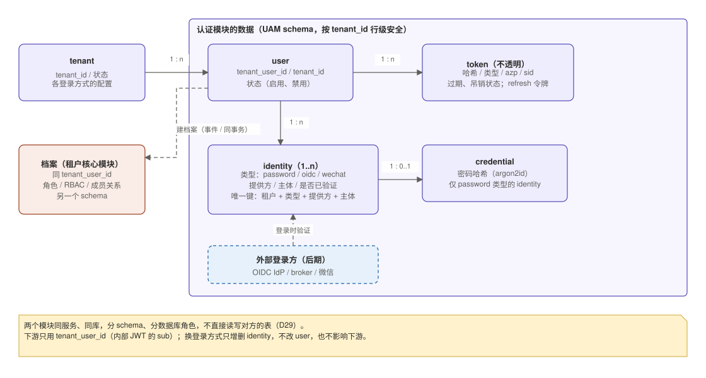
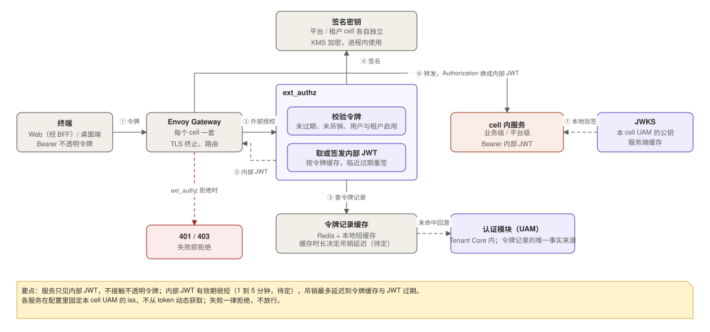

# 02 认证与 token 体系

状态：设计基线（尚未落地）。本文是 UAM、网关 ext_authz、BFF 及各服务验签实现的依据；决策见 [06](06-decisions.md)，待定项也在 06。

## 1. 原则

1. **终端只持有不透明令牌**，由 UAM 签发，本身不含信息，服务端查表得到身份。
2. **网关统一换发**：各 cell 网关的 ext_authz 校验不透明令牌，换成短有效期的内部 JWT 转发；内部 JWT 不出集群。
3. **服务每一跳都校验**：各服务用 JWKS 本地验签内部 JWT，不回调 UAM。
4. **登录方式与令牌解耦**：UAM 把各种登录方式归一成“已验证身份”，之后的令牌、网关、下游都不关心用户怎么登录的。
5. **各 cell 信任根分开**：每个 cell 有自己的网关、UAM、`iss` 与签名密钥，一个 cell 的服务只信本 cell 的 UAM，所以租户令牌访问不了平台级服务，反之亦然。
6. **授权不在 token 里**：token 只证明“你是谁、从哪来、在哪个租户”，角色、租户状态、已开通模块由 Tenant Core 提供（见 4.3）。

内部 JWT 不放 email、姓名等资料，因为它会透传到每个服务和日志里。

## 2. 多端接入

进入 cell 之后统一成内部 JWT，差别只在终端持有的凭证。staff 与租户用户走同一条路径，BFF 都不接触内部 JWT（D25）。

| 端 | 登录与凭证 | 要点 |
|---|---|---|
| Web（SSR） | 经 BFF 登录 UAM；令牌存在 Redis session，浏览器只有 HttpOnly + Secure + SameSite 的 session cookie | 令牌不到浏览器；BFF 无状态，才能水平扩展 |
| 桌面端 | 系统浏览器登录 UAM 的登录页，回调拿到令牌，存系统 Keychain / Credential Manager | public client，不保存 secret；回调走 loopback 或自定义 scheme；refresh 令牌轮换 |
| 外部服务 | 后期，随 broker 接入（见第 8 节） | 第一阶段不支持 |

## 3. UAM

UAM 是 Tenant Core 的认证模块，负责“你是谁”并签发凭证：

- 登录（第一阶段用户名密码），管理用户、登录身份与凭证；
- 签发、刷新、吊销不透明令牌；提供内部 JWT 的 JWKS；
- 管理接口：创建、禁用用户，重置密码，管理登录方式，吊销令牌；租户管理员经 Tenant BFF 调用，不直接访问；
- 响应租户开通事件，创建租户记录与登录配置；配置变更写审计；CLI 冷启动（见 6.5）。

它不负责业务授权，不保存档案与 RBAC（租户核心模块）、租户注册与模块授权（Platform Service）。前期与租户核心模块合并部署（D29）：一个服务、一个库，凭证与令牌表同档案表分 schema、分数据库角色，两个模块互不读写对方的表。


**部署**：同一份代码，每个 cell 一套，各有独立的库、`iss` 与签名密钥（D16、D28）。平台 cell 的 UAM 只服务 platform_staff；租户 cell 的 UAM 服务该 cell 内的租户，pool cell 里有多个租户，用 `tenant_id` 做逻辑隔离（表带 `tenant_id`，Postgres 行级安全，应用用受限数据库角色）；silo cell 的 UAM 天然独占。

**数据模型**：



identity 的唯一键是 (租户, 类型, 提供方, 主体)。平台租户是保留租户，租户管理接口不能创建、修改或读取它。

**Authenticator**：登录方式通过 `Authenticator` 接口接入，输入登录请求，输出统一的“已验证身份”（类型、提供方、主体、已验证属性）；“身份解析”按 (租户, 类型, 提供方, 主体) 找到 user，之后与登录方式无关。第一阶段只有 `PasswordAuthenticator`；`OidcAuthenticator`（租户 IdP、broker）与 `WeChatAuthenticator` 后期新增，不改令牌、网关和下游。

## 4. 令牌

### 4.1 不透明令牌

- 高熵随机串，带类型前缀（如 `tk_`）便于泄漏扫描；库里只存哈希。
- UAM 在签发与刷新时检查用户与租户状态，禁用或暂停即拒绝。
- 桌面端用 refresh 令牌并轮换；Web 由 BFF 在过期前主动刷新，多个实例并发刷新要加锁或幂等。
- 有效期与刷新方式待定（见 06）。

### 4.2 内部 JWT 契约

```json
{
  "iss": "https://uam.tenant.example.internal",
  "aud": "tenant-services",
  "sub": "tu_8f3a...",
  "exp": 1762000120,
  "iat": 1762000000,
  "jti": "b2c1...",

  "tenant_id": "t_1024",
  "cell_id": "pool-1",

  "scope": "order:read order:write",

  "client_type": "web",
  "azp": "tenant-admin-bff",
  "sid": "s_77e0..."
}
```

| 字段 | 说明 |
|---|---|
| `iss` | 所属 cell 的 UAM；各服务在配置里固定，不从 token 动态获取 |
| `aud` | `tenant-services` 或 `platform-services`（D13） |
| `exp` | 很短，建议 1 到 5 分钟（待定） |
| `sub` | 就是 `tenant_user_id`，下游只用它（D8） |
| `tenant_id` | 来自 UAM 的认证配置，是租户隔离的唯一可信来源 |
| `cell_id` | 所在 cell，用于审计与排查，不用于路由 |
| `scope` | 终端级的粗粒度范围，不放角色 |
| `client_type`、`azp`、`sid` | 终端类型（`web`、`desktop`，后期 `service`）、客户端、会话；由 UAM 按实际登录流程写入，不取客户端自述，用于收窄权限与审计 |

没有 `domain` 声明，也不需要：平台与租户靠不同的 `iss` 与密钥区分。`amr`（本次登录方式）是否写入待定。

### 4.3 角色的获取

业务服务按 `sub` 向 Tenant Core 查询用户的角色、租户状态和已开通模块（向下的同步调用），结果短 TTL 缓存。角色变更对新请求立即生效，不必等 token 过期；代价是该接口需要低延迟、高可用。接口的返回内容、缓存与降级行为待定（见 06）。

## 5. 网关与换发

每个 cell 网关的 ext_authz 是进入该 cell 的每个请求的必经环节（D18、D28）：



- 校验：令牌未过期、未吊销，用户与租户状态为启用；任何一步失败都拒绝。
- 缓存：令牌记录走 Redis 加本地短缓存；内部 JWT 按令牌缓存，临近过期再重签，避免每个请求都签名。缓存时长决定吊销延迟（待定）。
- 密钥：内部 JWT 的签名密钥在 ext_authz 进程内使用，KMS 加密保存，不每次调用 KMS；各 cell 的密钥分开。
- 前期不做通用限流，UAM 登录端点的失败锁定除外（D22）。

## 6. 登录与用户

### 6.1 密码登录

argon2id 哈希、密码策略、连续失败锁定、登录端点限流；找回密码经 Notification；凭证不进日志、不出 UAM（D22）。策略、阈值与找回流程待定。

### 6.2 用户的创建与状态

- **创建**（D20）：UAM 生成 `tenant_user_id`，发“用户已创建”事件，Tenant Core 以该 ID 幂等建档案，新用户没有角色。前期合并部署，档案在同一事务内创建，事件在进程内传递。
- **状态**（D31）：启用、禁用、删除以 UAM 为准，UAM 先吊销该用户的全部令牌，再单向同步给 Tenant Core。
- **来源**：第一阶段来自 CLI 冷启动与管理员创建（经 Tenant BFF 调用 UAM 管理接口），不做 JIT。

### 6.3 JIT（后期）

接入外部 IdP 后，可按租户与 IdP 的开关，允许登录时自动创建用户，并遵守：

1. 租户来自校验所用的认证配置，绝不取自外部声明；
2. 绑定键是 (租户, 类型, 提供方, 主体)，不用全局 `sub`，不按邮箱自动合并；
3. 新用户默认无角色；
4. 创建幂等，并发首次登录只建一个用户；
5. 租户暂停或用户禁用时拒绝签发；
6. 只对已验证域名的 IdP 允许按邮箱关联已有用户。

### 6.4 多种登录方式关联到同一用户（D21）

- 新增登录方式须在已登录状态下进行，且新方式自己也要通过验证；
- 解绑时至少保留一种可用登录方式；
- 一个外部身份只能绑定一个用户。

### 6.5 CLI 冷启动（D23）

- 范围：平台 cell 的平台租户、模块授权与第一个 staff；租户 cell 的初始租户与第一个租户管理员。
- 初始密码不作为命令行参数，改为交互输入、标准输入或一次性链接，首次登录强制改密。
- 幂等；只能在受控环境运行（如 Kubernetes Job）；执行记入审计。
- 日常开通走 Platform Service 的事件，租户注册表以它为准，CLI 写入的记录要与之对账（方式待定）。

### 6.6 退出与吊销

- 用户退出：BFF 删除 session，并通知 UAM 吊销对应令牌。
- 管理员强制下线、禁用用户或暂停租户：UAM 删除相应令牌，网关下一次校验就拒绝；BFF 的 session 在下一次请求发现令牌失效后清除。
- 已换发的内部 JWT 最多再存活到 `exp`，这是可接受的吊销延迟。

## 7. 密钥与 JWKS

- 每个 cell 的 UAM 有自己的签名密钥与 JWKS，只在集群内网提供，用 NetworkPolicy 限制访问；算法用 ES256 或 RS256，不用 HS256。
- 轮换要有重叠期：先加入新公钥，下游缓存刷新后再切换签名，旧公钥至少保留一个内部 JWT 最大有效期后再删除。
- 各服务按配置里写好的 `iss` 取 JWKS，本地缓存数分钟，未知 `kid` 时限频刷新一次，UAM 短暂不可用时继续用缓存。

```java
JwtIssuerAuthenticationManagerResolver resolver =
    new JwtIssuerAuthenticationManagerResolver(trustedIssuers::contains);
// trustedIssuers 来自配置，各 cell 只含本 cell UAM 的 iss
```

## 8. 后期：broker、外部 IdP 与外部服务

第一阶段不引入 broker（如 Keycloak）。以下都作为新的 Authenticator 或接口接入，不影响令牌契约与下游（D17、D24）：

- **租户自带 OIDC IdP**：每租户可配置多个，经 UAM 管理；须防 SSRF（只允许 https，拦截内网与保留地址，设超时与响应大小上限）；租户至少保留一种可用登录方式；IdP 禁用而不是删除，禁用时吊销该 IdP 登录产生的令牌。
- **broker**：登录由 broker 完成，UAM 验 broker 签发的 token，按 6.3 解析身份。
- **外部服务（M2M）**：先在 broker 登录，UAM 验 broker 的 token，再换不透明令牌；权限范围以 UAM 登记为准，不取 broker 的声明；令牌 `client_type` 为 `service`，没有对应用户。
- **微信**：新增 `WeChatAuthenticator`。

## 9. 完整交互

以租户用户通过 Web 用密码登录并调用业务接口为例：


其他场景沿用同一套结构：

- staff：Platform BFF 对平台 UAM 登录，请求经平台 cell 网关的内部 listener 换发，服务验平台 UAM 的 `iss`。
- 桌面端：系统浏览器登录，回调拿到令牌，直接带它调用网关。
- 刷新：BFF 或桌面端用 refresh 令牌向 UAM 刷新，UAM 检查用户与租户状态并轮换 refresh 令牌。
- 服务间：用户发起时透传内部 JWT；定时任务、事件消费者用 service token（见 03）。
