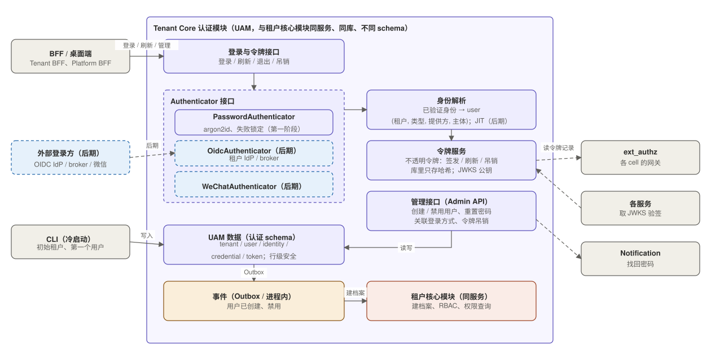
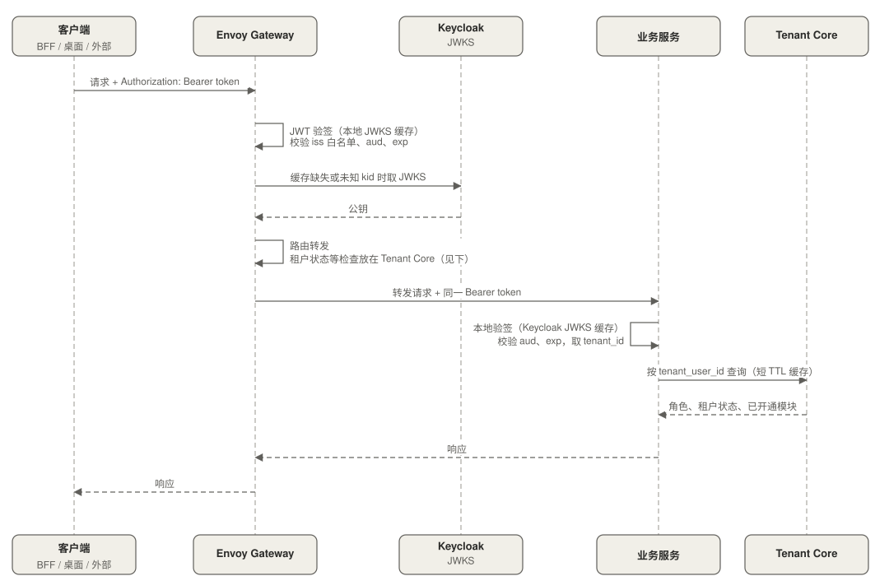
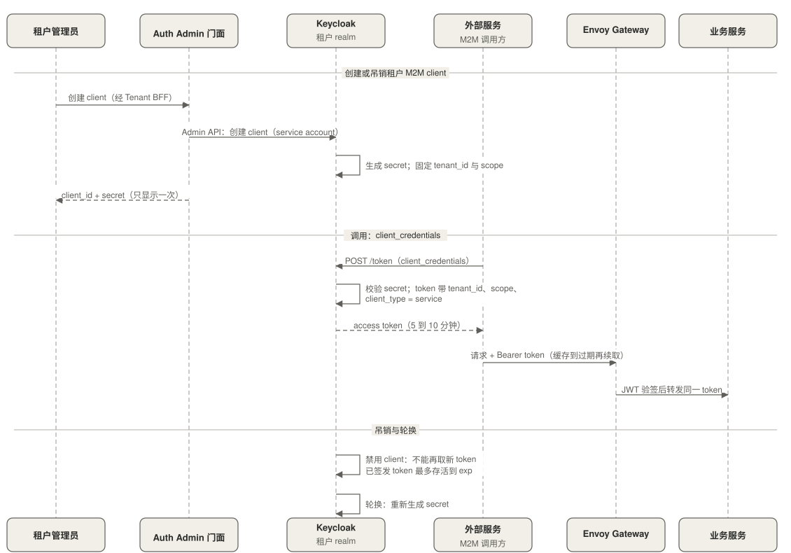
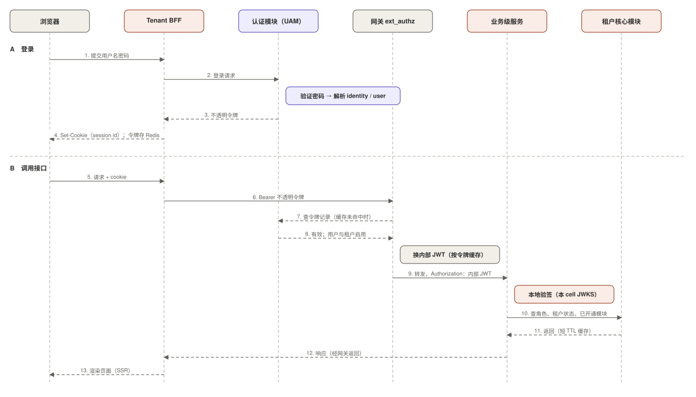

# 02 认证与 token 体系

状态：设计基线（尚未落地）。本文是 Keycloak、Auth Admin 门面、Envoy Gateway、BFF 及各服务验签实现的根本依据。

## 1. 原则

所有 token 由 Auth 服务签发，边界与服务只验证、不换发：

1. user token 与 M2M token 由 Keycloak 签发，有效期 5 到 10 分钟，靠 refresh token 续期。
2. Envoy Gateway 用 JWT 验证做边界校验：本地验签，检查 `iss` 白名单、`aud`、`exp`，通过后转发同一个 token。
3. 内部服务只认 token，通过 JWKS 在本地验签，不回调认证服务。
4. staff 与租户用户使用不同的身份域（不同的 `iss` 和 `aud`），租户 token 即使泄漏，也无法访问平台 API。
5. IdP 由 Keycloak 统一对接，上层只依赖统一的 token 契约，租户新增 IdP 不影响下游服务。

token 里不放 email、姓名等资料，只放授权所需的字段，因为它会被透传到每个内部服务和日志里。桌面端与外部服务持有的 token 泄漏后，在有效期内可被使用，要求更高时再加 DPoP 或 mTLS 绑定（待定）。

staff 路径：staff 在 Keycloak 的 staff realm 登录，Platform BFF 存入自己的 session，经内网直接调用 Platform Service，Platform Service 自己验签，不经过 Envoy Gateway。

## 2. 多端接入

三类端点的差别在凭证形态，进入内部之后统一成同一种 token。

| 端 | 认证方式 | 凭证存放 | 要点 |
|---|---|---|---|
| Web（SSR） | 经 BFF 登录，BFF 持有 user token | 浏览器只有 HttpOnly + Secure + SameSite 的 session cookie | token 不到浏览器，避开 XSS 偷 token；BFF 无状态化（session 放 Redis）才能水平扩展 |
| 桌面端 | Authorization Code + PKCE，通过系统浏览器登录 | 系统 Keychain / Credential Manager | public client，不能保存 client secret；回调走 loopback 或自定义 scheme；refresh token 开启轮换 |
| 外部服务 | OAuth2 client_credentials（前期不做 API Key） | 调用方自行保管 client secret | secret 只显示一次，绑定租户和 scope，可吊销、轮换；Webhook 回调用 HMAC 签名 |

## 3. Auth 服务

### 3.1 定位

Auth 服务负责“你是谁”并签发凭证：

- 对客户端（BFF、桌面端、外部服务）是标准 OIDC Provider；
- 对外部 IdP（租户自带的 OIDC IdP，后期微信）是依赖方，把各种登录方式归一成统一身份；
- 签发 token，并提供 JWKS。

它不负责业务授权，也不保存租户用户资料与 RBAC（Tenant Core）、租户注册与模块授权（Platform Service）。

### 3.2 前期部署

一个 Keycloak 集群，由自研的 Auth Admin 门面管理。



| 项 | 做法 |
|---|---|
| 租户隔离 | 一个租户一个 realm，`iss` 为 `https://auth.../realms/{租户}`，用户、IdP、client、密钥各自独立 |
| staff | 单独一个 staff realm，管理员账号与租户 realm 分开；将来可拆成独立实例 |
| 登录用户 | 使用 Keycloak 内置用户（邮箱密码）；租户可另外配置自己的 OIDC IdP |
| 租户注册表 | 记录每个租户的 `auth_issuer`（realm 的 `iss`），Gateway 与服务的可信 `iss` 清单由它生成 |
| 开通租户 | provisioning 流程中用脚本创建 realm、BFF client、桌面 client、mapper 与登录主题（见 04） |
| silo | 默认共用同一个 Keycloak 集群；有合规、数据驻留、独立密钥要求时，才为该租户部署独占的 Keycloak 实例，租户注册表的 `auth_issuer` 指向它 |

`tenant_id` 在每个 realm 里固定配置，所以 `iss` 与 `tenant_id` 天然绑定，某个租户的 realm 无法签发其他租户的 token。

### 3.3 Auth Admin 门面

租户管理员不直接访问 Keycloak 控制台，经 Tenant BFF 调用门面，由门面调用 Keycloak Admin API。门面负责：

- 租户 IdP 配置管理：新增、修改、禁用；
- M2M client 管理；
- 用户同步：订阅 Tenant Core 的用户事件，在租户 realm 创建、禁用用户，并写入 `tenant_user_id` 属性；
- 开通租户时创建 realm 及 client、mapper；
- 配置变更审计；
- 承载安全规则（见 5.2）。

规则放在门面里，以后换成其他 Auth 实现，租户管理界面不用改。

## 4. token 契约

### 4.1 claims

```json
{
  "iss": "https://auth.example.com/realms/acme",
  "aud": "tenant-services",
  "sub": "f3a9c1d2-...",
  "exp": 1762000300,
  "iat": 1762000000,
  "jti": "b2c1...",

  "domain": "tenant",
  "tenant_id": "t_1024",
  "tenant_user_id": "tu_8f3a...",
  "cell_id": "pool-1",

  "scope": "order:read order:write",

  "client_type": "web",
  "azp": "tenant-admin-bff",
  "sid": "s_77e0..."
}
```

| 分组 | 字段 | 说明 |
|---|---|---|
| 标准 | `iss`、`aud`、`exp`、`iat`、`jti` | 每个身份域一个 `aud`（`tenant-services`、`platform-services`），透传给下游时不换发 |
| 主体与租户 | `sub`、`domain`、`tenant_id`、`tenant_user_id`、`cell_id` | `tenant_id` 在 realm 里固定，是租户隔离的唯一可信来源；`sub` 是 Keycloak 的不透明用户 ID，下游不依赖它，只用 `tenant_user_id`；`cell_id` 用于路由 |
| 授权 | `scope` | 只放 client 级的粗粒度范围，不放 `roles` |
| 来源 | `client_type`、`azp`、`sid` | 由 Keycloak 按实际授权流程写入（授权码、client_credentials），不取客户端自述 |

staff token 的 `domain` 为 `staff`，`aud` 为 `platform-services`，没有 `tenant_id` 与 `cell_id`。

M2M token 没有 `tenant_user_id`，`client_type = service`，`sub` 是 client 的 service account。

### 4.2 roles 的获取

token 只证明“你是谁、从哪来、在哪个租户”。用户的角色、租户状态和已开通模块由 Tenant Core 提供：

- 业务服务按 `tenant_user_id` 向 Tenant Core（核心域层）查询，属于向下的同步调用，符合分层规则；
- 结果在服务内短 TTL 缓存；
- 角色变更对新请求立即生效，不必等 token 过期，Keycloak 也不需要同步角色；
- 代价：业务服务对 Tenant Core 多一个调用，该接口需要低延迟、高可用。

接口的返回内容、缓存 TTL、失效方式、Tenant Core 不可用时的降级行为为**待定**（见 06）。

### 4.3 终端来源的判定

| 来源 | Keycloak 的判断依据 | `client_type` | `sub` |
|---|---|---|---|
| Web（经 BFF） | BFF 作为第一方 client 走授权码流程，`azp` 是 BFF | `web` | 用户 |
| 桌面端 | PKCE 流程获得的 token，`azp` 是桌面 client | `desktop` | 用户 |
| 外部服务（M2M） | client_credentials token | `service` | client 的 service account |

来源信息的用途：

- 收窄权限：同一用户从桌面端和 Web 登录，scope 可以不同；M2M token 的 scope 通常比用户 token 小得多，且不对应具体用户。
- 审计：记录 `client_type`、`azp`、`sid`，事后能还原是谁、从哪类端点、哪个会话发起。

业务服务里尽量少写“如果是某个终端就怎样”的分支。终端差异应在边界转换成 scope，用户的角色与权限由 Tenant Core 提供，服务只看权限。

## 5. 租户自带 IdP 与登录

### 5.1 配置与选择

租户的 IdP 直接配置在该租户的 Keycloak realm 里（Identity Provider），每个租户可配置多个，通过 Auth Admin 门面管理。

登录时如何选 IdP：

- 租户专属的登录入口（子域名或 org slug）对应该租户的 realm，登录页列出该 realm 的本地登录和已启用的 IdP；
- 可用邮箱域名发现，直达对应 IdP；
- 客户端也可以带 hint 参数直接指定。

### 5.2 安全要求（由门面与 Keycloak 配置保证）

- 租户填写的 issuer / JWKS 地址要防 SSRF：只允许 https，拦截内网与保留地址，设超时与响应大小上限，并缓存。
- `tenant_id` 来自 realm 的固定配置，绝不取自 IdP 返回的 claims；用户的角色由 Tenant Core 决定，不由 IdP 的 claims 映射。
- 仅对可信（已验证域名）的 IdP 允许按邮箱自动关联已有用户，否则容易被冒用邮箱接管账号。
- 标准校验不可省：`state`、`nonce`、`aud`、`iss`、签名，由 Keycloak 保证。
- 防止租户把自己锁死：至少保留一种可用登录方式和本地应急管理员；IdP 禁用而不是删除；禁用时吊销该 IdP 的会话。
- 开启 Keycloak 自带的暴力破解检测，保护登录与 token 端点。

微信为后期：用社区的微信 IdP 扩展，或自己写 Keycloak SPI，到时先验证可用性。

## 6. 用户与会话的归属

用户分两层，会话分三层，Auth 只负责其中与“你是谁”相关的部分：

| 对象 | 内容 | 归属 |
|---|---|---|
| Identity | Keycloak 内置用户的登录凭证、与外部 IdP 的绑定、登录状态 | Auth 服务（Keycloak） |
| tenant_user 档案 | 资料、成员关系、角色与 RBAC、启用/禁用 | Tenant Core |
| platform_staff 档案 | 资料与角色 | Platform Service |
| BFF 应用会话 | HttpOnly cookie 对应的 Redis session，存 user token | Platform BFF / Tenant BFF |
| Auth 侧会话 | 授权码、refresh token、SSO 会话 | Keycloak |
| token | 5 到 10 分钟内有效的无状态 token | 不存储 |

**用户生命周期（预置）**：

- 创建：租户管理员在 Tenant Core 创建 `tenant_user`，Tenant Core 发出事件；Auth Admin 门面订阅后，在该租户 realm 创建 Keycloak 用户，并把 `tenant_user_id` 写入用户属性，由 mapper 输出到 token。
- 禁用或删除：在 Tenant Core 操作，事件到达后，门面在 Keycloak 禁用用户并吊销其会话。
- JIT 不做：不支持“首次登录自动创建用户”，租户自带 IdP 的用户也需要先在 Tenant Core 创建。

**退出与吊销**：

- 用户退出：BFF 删除自己的 session，并调用 Keycloak 的退出接口，吊销对应的 refresh token。
- 管理员强制下线或禁用用户：Keycloak 通过 OIDC Back-Channel Logout 通知 BFF 清除对应 session，这是标准机制，不需要自定义事件。
- Gateway 与下游不查会话状态，已签发的 token 最多再存活 5 到 10 分钟，这是可接受的吊销延迟。

## 7. 边界验证



Envoy Gateway 用内置的 JWT 验证配置多个 provider（每个 realm 一个 `iss`，远程 JWKS），在本地验签，检查 `iss` 白名单、`aud`、`exp` 后转发同一个 token。前期不做任何限流，也不做租户状态拦截；租户状态与模块是否开通由 Tenant Core 的权限查询接口一起返回，业务服务在同一次查询里判断。

## 8. client 与 M2M 登记

| 类别 | 例子 | 归属 | 管理方 |
|---|---|---|---|
| 第一方 client | Tenant BFF、Platform BFF、桌面客户端 | 对应 realm 的 client（Platform BFF 在 staff realm，其余在租户 realm） | 平台运维，开通租户时由脚本创建 |
| 租户 M2M client | 外部服务调用方 | 租户 realm 里开启 service account 的 client | 租户管理员，经 Tenant BFF 调 Auth Admin 门面 |

租户 M2M client 登记在租户侧的 realm 里，满足“租户内部数据对平台侧不可见”。



要点：

- secret 创建时只显示一次；Keycloak 支持按策略轮换 secret，可设过期时间。
- token 里的 `tenant_id` 由 realm 固定，不取自请求参数；`client_type = service`；scope 取登记范围。
- 吊销：禁用 client 后不能再取新 token，已签发的 token 最多再存活到 `exp`。
- `client_id` 全局唯一，用前缀区分类别，例如第一方用 `fp_`，租户 M2M 用 `mc_`。
- 调用方要缓存 token 到过期再续取。
- 如果以后有客户要求静态 API Key，再作为兼容层加：由单独组件查 key 后换发 token，届时才需要 key 投影与事件同步。

## 9. JWKS 与密钥

- 每个 realm 在内网提供 JWKS：租户侧每租户一个，staff 一个。不同 realm 使用不同的 `iss` 和密钥对。
- 前期签名密钥保存在 Keycloak 自己的库里；Keycloak 默认不接 KMS，需要额外的密钥提供者扩展，前期接受这个风险，后期有合规要求再处理。算法用 ES256 或 RS256，不用 HS256。
- 轮换要有重叠期：先加入新公钥，下游缓存刷新后再切换签名，旧公钥至少保留一个 token 最大有效期后再删除。
- Gateway 与各服务：按配置里预先列出的 `iss` 取对应 JWKS，不根据 token 里的 `iss` 动态拉取；本地缓存数分钟，未知 `kid` 时限频刷新一次；Keycloak 短暂不可用时继续使用缓存。
- `iss` 白名单由租户注册表的 `auth_issuer` 生成，租户开通时更新；JWKS 端点只暴露在集群内网，用 NetworkPolicy 限制访问。

Spring Boot 的 Resource Server 可以只接受白名单内的 issuer：

```java
JwtIssuerAuthenticationManagerResolver resolver =
    new JwtIssuerAuthenticationManagerResolver(trustedIssuers::contains);
// trustedIssuers 来自租户注册表生成的 realm iss 清单，不从 token 动态获取
```

## 10. 完整交互

以租户用户通过 Web 登录并调用业务接口为例：



其他场景沿用同一套结构：

- staff 登录：Platform BFF 走同样的授权码流程，对 staff realm，`domain = staff`。
- 桌面端：直接向租户 realm 发起授权码 + PKCE，拿到 token 后调用 Envoy Gateway。
- 外部服务（M2M）：向租户 realm 的 `/token` 用 client_credentials 取 token，再带着它调用 Envoy Gateway。
- token 刷新：BFF 用 refresh token 向 Keycloak 刷新，由 Keycloak 负责轮换与吊销。
- 服务间调用：用户发起时透传原 token；定时任务、事件消费者用 service account 通过 client_credentials 取 service token（见 03）。

## 11. 切换到 SAS 的预案

前期用 Keycloak 不是终点：租户数量增长到管理或性能明显吃力（几百个以上）、需要用 KMS 签名或更细的 claims 定制、微信等适配在 Keycloak 上难以维护、每个 realm 的运维成本过高时，可以换成 Spring Authorization Server（SAS）加自研 broker。

只要守住下面的边界，切换对下游服务和客户端透明：

1. 下游只认 token 契约：Gateway 与各服务只依赖 JWKS、可信 `iss` 清单和 4.1 的 claims，不依赖 Keycloak 特有的字段。
2. 不依赖 Keycloak 的用户 UUID：下游只用 `tenant_user_id`，否则迁移用户时所有 `sub` 都要重新对应。
3. 不向租户暴露 Keycloak 控制台：所有管理操作经 Auth Admin 门面。
4. 角色不进 Keycloak：角色在 Tenant Core，迁移时不需要搬角色。

切换后的分工：

| 部分 | 来源 |
|---|---|
| 授权码 + PKCE、client_credentials、refresh 轮换、discovery、JWKS 端点 | SAS |
| 授权码、授权记录、refresh token 存储 | SAS 的 JDBC 实现 |
| 通用 OIDC 对接 | Spring Security OAuth2 Client，`ClientRegistrationRepository` 换成读取自建 `idp_connection` 表的实现 |
| 微信等适配器 | 自研，实现统一的 `IdpAdapter` 接口 |
| `idp_connection`、`identity_binding`、Admin API | 自研；连接配置含 secret，只存引用（指向 KMS） |
| 登录页（租户品牌、列出 IdP、按邮箱域名发现） | 自研 |
| claims 填充 | `OAuth2TokenCustomizer`，`tenant_user_id` 取自事件同步的只读投影 |
| 签名 | 自定义 `JWKSource` / `JwtEncoder`，调用 KMS sign，私钥不落盘 |

迁移时需要做的是迁移用户与 IdP 配置，并确认所用 SAS 版本对 token exchange（RFC 8693）的支持程度。

## 12. 待定项

- Tenant Core 权限查询接口的返回内容、缓存 TTL、失效方式与降级行为。
- token 有效期取 5 分钟还是 10 分钟，以及是否为桌面端与外部服务启用 DPoP 或 mTLS 绑定。
- Keycloak 的高可用与备份方案，以及它宕机时对登录与续期的影响。
- Keycloak 签名密钥是否前期就接 KMS。
- 微信接入方式（社区扩展还是自写 SPI）。
- Envoy Gateway 按多个 `iss` 配置 JWT 验证、Keycloak 对 service account 的 client_credentials 支持，落地前需各验证一遍。
