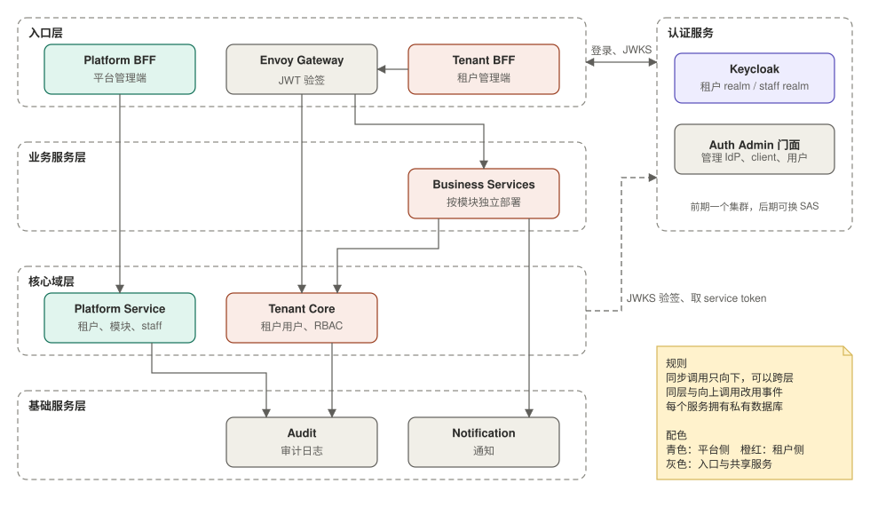
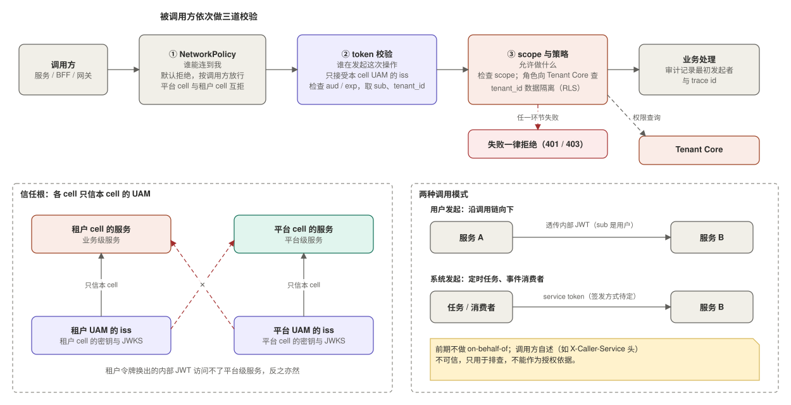

# 03 服务分层与服务间信任

状态：设计基线（尚未落地）。本文按 [06-decisions.md](06-decisions.md) 的 D14、D18、D25 到 D27 同步，是各服务之间依赖方向、调用方式与信任校验的依据。

## 1. 服务分层

分四层：入口层、业务服务层、核心域层、基础服务层。UAM 作为侧栏，不属于任何一层。

业务服务层再分两类（D27），二者并列，分属不同的 cell：

| | 平台级服务 | 业务级服务 |
|---|---|---|
| 例子 | Platform Service、未来的数据分析 | 租户的各业务模块 |
| 部署 | 只在平台 cell | 租户 cell（pool 或 silo） |
| 服务对象 | 平台 staff | 租户用户 |
| 信任的 `iss` | 平台 UAM | 租户 UAM |

规则：

- 同步调用只向下，可以跨层，例如 Envoy Gateway 直接调 Tenant Core。
- 同层之间不做同步调用，向上也不能同步调用，这些场景一律改成事件。入口层内部的 Tenant BFF → Envoy Gateway 是入口链路，不受此限。
- **平台级服务与业务级服务之间不做同步调用**：它们在不同 cell，只通过 Event Bus 交互。业务级服务不依赖平台级服务；租户注册与模块授权经事件投影到本 cell 的 Tenant Core，由 Tenant Core 提供查询。
- 基础服务（Audit、Notification）只提供能力，不依赖任何上层服务。
- 每个 cell（平台 cell、租户 cell）是独立的纵向链路，有自己的网关与 UAM，cell 之间互不调用，只通过 Event Bus 交互（D28）。
- 每个服务拥有自己的数据库，其他服务不能直连，只能通过接口或事件访问。
- 需要立即响应的查询或命令用同步调用（REST/gRPC），要有超时、重试和熔断；跨领域的状态变更用事件（Outbox + Event Bus，见 05）。
- 对侧栏的访问不受“只向下”的约束：入口层向 UAM 登录；各 cell 的 ext_authz 读本 cell 的 UAM 令牌数据；各层向本 cell 的 UAM 取 JWKS 验签；系统发起的调用需要 service token（签发方式待定，见 06）。

这样做是为了避免循环依赖，并让故障影响范围可预期：基础服务影响面最大，所以要最简单、最稳定。

分层是调用约束，不要求每一层都有独立的部署单元。例如前期 UAM（侧栏）与 Tenant Core（核心域层）合并部署为一个服务（D29），模块之间仍遵守本文的依赖方向与边界。

## 2. 服务间信任

采用 zero trust：每一跳都校验。前期不上 Service Mesh，被调用方依次做三道校验，分别回答三个不同的问题：

| 校验 | 回答的问题 | 做法 |
|---|---|---|
| NetworkPolicy | 谁能连到我 | k8s NetworkPolicy 默认拒绝，只放行允许的调用方；属于网络层限制，不做密码学身份校验。平台 cell 与租户 cell 之间默认互相拒绝 |
| token | 谁在发起这次操作 | 本地验签内部 JWT，只接受本 cell 的 UAM 的 `iss`，检查 `aud` 和有效期，取 `sub`（即 `tenant_user_id`）、`tenant_id`、`client_type` |
| scope 与策略 | 允许做什么 | 检查 scope；用户的角色与权限向 Tenant Core 按 `sub` 查询（可短 TTL 缓存）；数据层按 `tenant_id` 隔离（如 RLS，silo 租户独占库） |

### 2.1 信任根

平台级与业务级服务信任不同的 UAM（D26、D27）：

- 租户 cell 的服务只接受租户 UAM 的 `iss`，平台 cell 的服务只接受平台 UAM 的 `iss`。
- 因此租户用户的令牌换出的内部 JWT 无法访问平台级服务，反之亦然，不需要再靠 `domain` 声明区分。
- 令牌的 `iss` 在各服务的配置里固定，不从 token 动态获取（见 02）。

### 2.2 “来源”识别

前期“来源”只有一层：

- **最初发起者**（哪个用户、哪类终端）：看内部 JWT 的 `sub`、`azp` 和 `client_type`。
- **直接调用方**（哪个服务）：由 NetworkPolicy 限定可连接的范围，不做密码学证明。透传场景下，被调用方 B 不能可靠地知道调用是服务 A 触发的；请求头里的调用方名称由调用方自己填写，只能用于排查，不能作为授权依据。审计靠 trace id 还原调用链。

如果某个内部接口确实需要限定调用方，按成本由低到高：

1. 按调用方收紧 NetworkPolicy：对该接口所在的服务，只允许特定服务的 Pod 连接。
2. Kubernetes ServiceAccount 令牌：调用方带上 k8s 为它签发、指定了受众的令牌，被调用方通过 TokenReview 校验，得到可验证的调用方身份。
3. 后期上 mTLS（SPIFFE 身份加授权策略），由 Service Mesh 统一提供。

### 2.3 两种调用模式

| 模式 | 场景 | 带什么 | 被调用方看到 |
|---|---|---|---|
| 用户发起 | 用户操作，沿调用链向下 | 透传网关换发的内部 JWT | `sub` 是用户 |
| 系统发起 | 定时任务、事件消费者，没有用户上下文 | service token（签发方式待定，见 06） | `sub` 是服务自己，没有用户信息 |

前期不做 on-behalf-of（令牌交换）：服务需要代用户做事时，直接透传内部 JWT；事件消费者需要租户上下文时，从事件里取 `tenant_id`。

服务只见内部 JWT，不接触不透明令牌；不透明令牌只存在于终端、BFF 和网关之间。

### 2.4 注意点

- 调用方自述不可信：不要信任“X-Caller-Service”这类请求头。
- 透传 token 不等于信任整条链，每一跳仍要独立校验 `iss`、`aud`、`exp` 与租户隔离。
- 授权分两级：网关只做校验、换发与路由，服务内部做细粒度（RBAC、模块是否开通、数据级权限）。
- 审计记录最初发起者（来自 token）与 trace id。
- 事件消费者处理事件时，租户上下文来自事件里的 `tenant_id`，写入数据时同样要按 `tenant_id` 隔离。

## 3. 待定项

- Tenant Core 权限查询接口的降级行为：缓存失效且 Tenant Core 不可用时，拒绝请求还是使用旧值（见 06）。
- 哪些内部接口需要限定调用方，以及采用 2.2 中的哪种做法。
- 系统发起调用的 service token 如何签发（见 06）。
