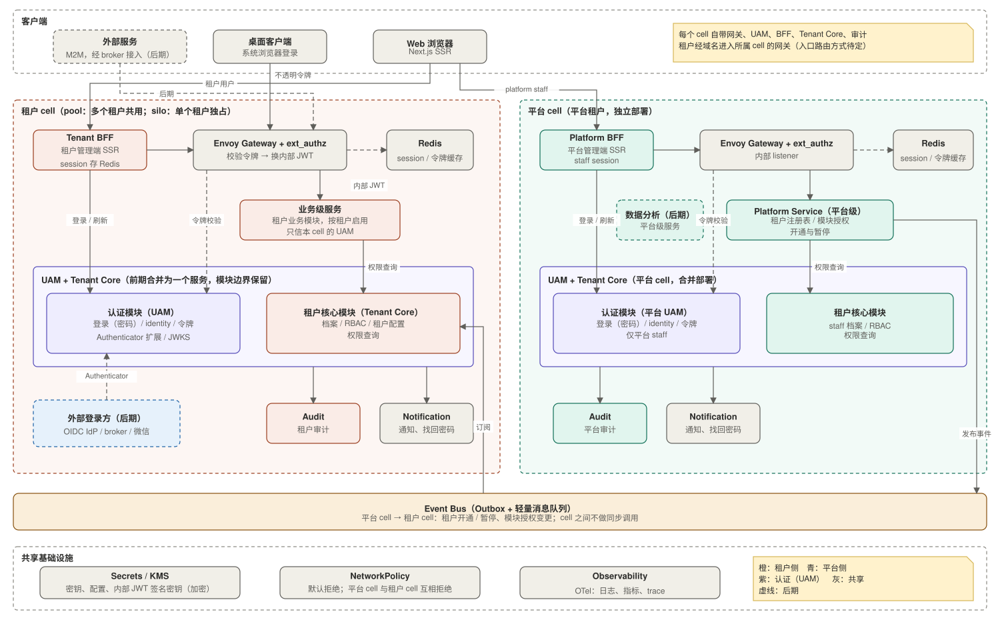

# 系统架构设计（system-design）

本目录沉淀 SaaS 微服务平台的架构设计，是各组件实现的根本依据。

> **当前状态：设计基线，尚未落地。** 本目录内容来自 `specs/saas-platform-architecture/research.md` 的调研结论。实现开始后，随实现演进更新，使之保持“当前真实状态”（见仓库根目录 `AGENTS.md` 对 `docs/system-design/` 的定义）。

## 如何使用

- 实现任一组件前，先读 [01-overview.md](01-overview.md) 中该组件的职责行，再读相关主题文档；组件的边界、数据归属、依赖方向以这里为准。
- 设计或需求发生变更时，按根目录 `AGENTS.md` 的规则：先更新 `specs/<功能>/` 下的 `spec.md`、`plan.md`、`tasks.md`，经确认后再改实现；实现落地后回写本目录。
- 每份文档的末尾或 [06-decisions.md](06-decisions.md) 记录待定项。待定项定下来之后，把结论写进正文，并从待定项里删除。
- 文档里的状态标记：**已定**表示可作为实现依据；**待定**表示尚未决定，实现时不得自行假设。

## 目录

| 文档 | 内容 |
|---|---|
| [01-overview.md](01-overview.md) | 背景与约束、术语、总览图、四层分层、组件职责表、前期取舍 |
| [02-authentication.md](02-authentication.md) | Auth 服务（Keycloak）、token 契约、多端接入、M2M、JWKS、用户与会话归属、租户 IdP、切换 SAS 的预案 |
| [03-service-layering-and-trust.md](03-service-layering-and-trust.md) | 服务分层与调用规则、服务间调用的信任与来源识别 |
| [04-multi-tenancy.md](04-multi-tenancy.md) | 租户注册表、pool / silo、`cell_id` 路由、租户开通流程、模块授权 |
| [05-events.md](05-events.md) | Event Bus 与 Outbox 约定、事件目录 |
| [06-decisions.md](06-decisions.md) | 关键决策记录、前期省掉的功能与触发条件、待定项 |
| `assets/` | 架构图（draw.io 的 `.drawio.svg`，可直接用 draw.io 打开编辑，也可在 Markdown 中渲染） |

## 一页摘要

- **两条独立链路**：平台侧与租户侧分库、分审计、互不同步调用，只通过 Event Bus 交互；租户用户与租户内部数据对平台侧不可见。
- **四层分层**：入口层、业务服务层、核心域层、基础服务层；同步调用只向下，同层与向上调用改用事件；认证服务作为侧栏。
- **认证**：前期用 Keycloak，每个租户一个 realm，staff 单独一个 realm；登录使用 Keycloak 内置用户，租户可配置自己的 OIDC IdP；所有 token 由 Keycloak 签发，Envoy Gateway 与各服务只做本地验签，不换发。
- **token 契约**：`tenant_id` 来自 realm 的固定配置；用户的角色、租户状态、已开通模块由 Tenant Core 提供，不进 token。
- **前期不做**：Edge Auth、Service Mesh、任何限流、JIT、API Key、on-behalf-of。触发条件见 [06-decisions.md](06-decisions.md)。

## 图

