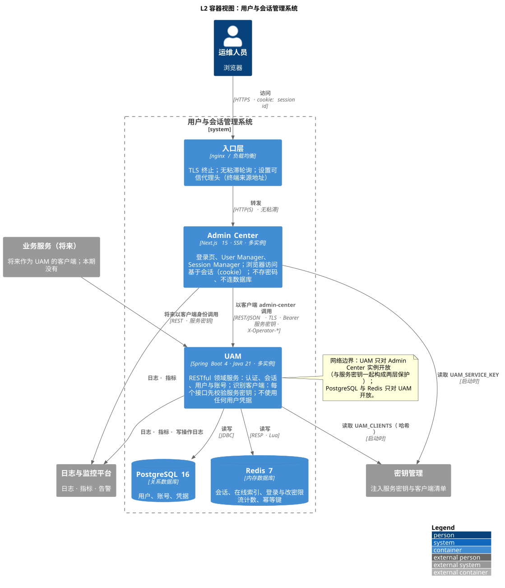
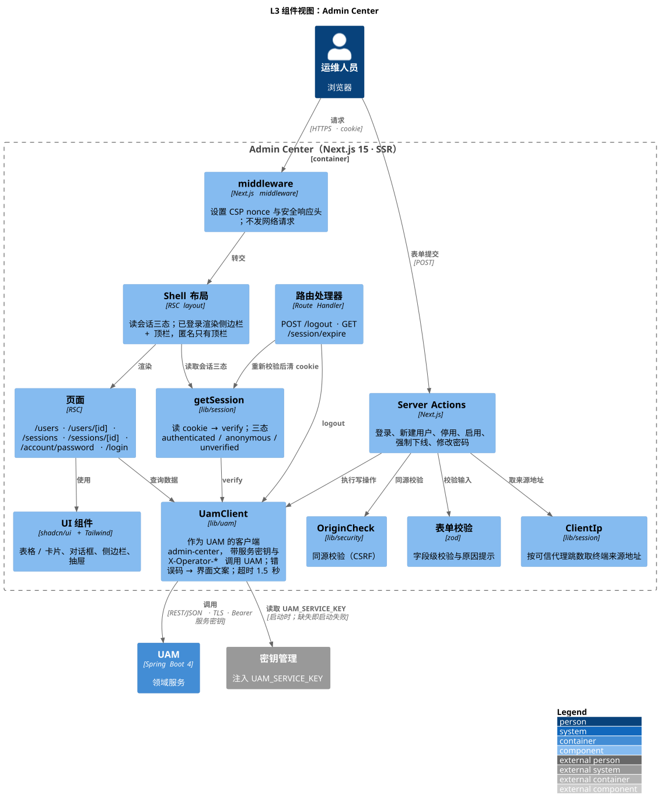
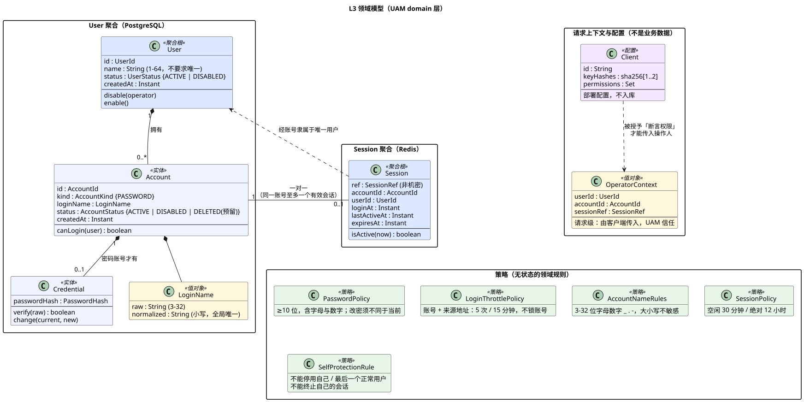
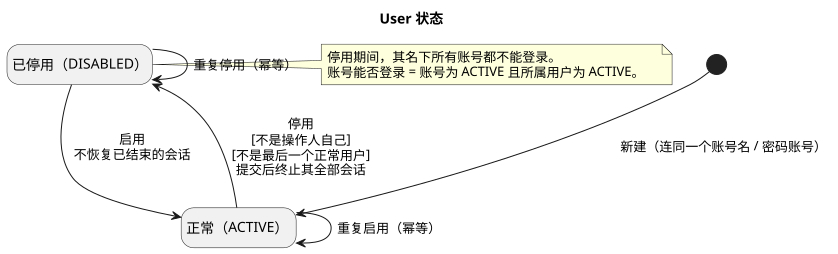
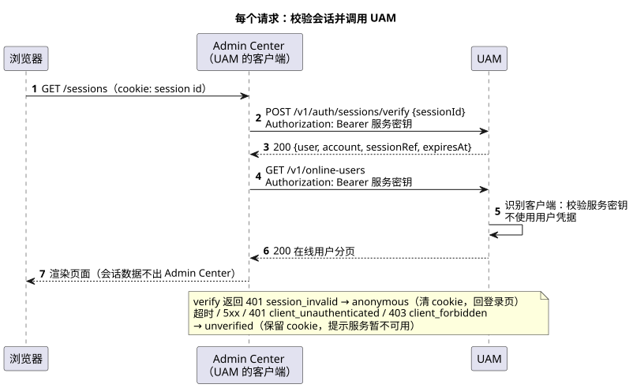
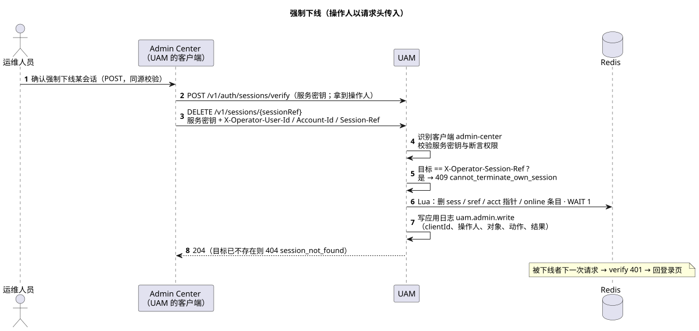

# Admin Center + UAM — 架构与实现（现状归档）

> **归档状态**：特性 `002-admin-center-uam` 已交付并归档。本文是**当前真实的架构与实现**，需求、领域与行为叙述见 [docs/achieve-specs/admin-center-uam.md](../achieve-specs/admin-center-uam.md)。
> `specs/002-admin-center-uam/{plan,research,data-model}.md` 是过程记录；与本文不一致时**以本文和代码为准**（偏差清单见 achieve-specs §9）。
> 图的 PlantUML 源文件与渲染好的 SVG 都在 [`diagrams/`](./diagrams/)（归档时从 `specs/002-admin-center-uam/diagrams/` 迁入，并按已落地的代码校对、更新过）。改图后重新渲染：`java -jar plantuml.jar -tsvg -charset UTF-8 docs/system-design/diagrams/*.puml`（GitHub 不渲染 PlantUML，SVG 须与源文件一同提交）。

## 1. 总览

| 服务 | 路径 | 技术 | 状态 |
|---|---|---|---|
| UAM | `apps/uam` | Java 21、Spring Boot 4.0.x（Web MVC、Validation、JDBC、Data Redis / Lettuce、Actuator、Flyway 社区版）、`spring-security-crypto` + BouncyCastle（Argon2id）、Micrometer | 无实例本地状态；状态在 PostgreSQL 与 Redis |
| Admin Center | `apps/admin-center` | TypeScript 5、Node 22、Next.js 15（App Router、SSR、Server Actions）、React 19、Tailwind CSS 4、shadcn/ui（Radix）、zod | 无状态、无存储；`output: "standalone"` |
| PostgreSQL 16 | — | 用户、账号、凭据（强一致） | 单主 |
| Redis 7 | — | 会话、索引、限流计数、幂等键；AOF `everysec` | 单主，不使用 Cluster |
| 契约 | `contracts/uam/openapi.yaml` | OpenAPI 3.1，错误体 RFC 9457 `problem+json` | UAM 契约唯一权威 |

两个服务可各自独立增减实例；任一实例处理任一请求，**不需要会话粘滞**。

## 2. C4 视图

### 2.1 L1 系统上下文

运维人员经浏览器使用「用户与会话管理系统」（Admin Center + UAM）。将来的业务服务可作为 UAM 的客户端（本期没有）。服务密钥与客户端清单由密钥管理在部署时注入；日志、指标与告警由监控平台收集。源文件：[c4-l1-context.puml](./diagrams/c4-l1-context.puml)。

### 2.2 L2 容器

| 容器 | 职责 |
|---|---|
| 入口层（nginx / 负载均衡） | TLS 终止；无粘滞轮询；追加可信代理头 `X-Forwarded-For`（供 Admin Center 取终端来源地址）。本仓库只提供本地编排用的 nginx（§4），生产入口是部署配置。 |
| Admin Center | 登录页、User Manager、Session Manager；浏览器访问基于会话（cookie）；每个请求先向 UAM `verify`；不存密码、不连数据库。 |
| UAM | 认证、会话、用户与账号；每个接口先校验服务密钥；不使用任何用户凭据。 |
| PostgreSQL | 用户、账号、凭据。 |
| Redis | 会话、在线索引、登录与改密限流计数、幂等键。 |

约定：浏览器 → Admin Center 为 HTTPS，cookie 只含机密的会话标识；Admin Center → UAM 为 REST/JSON（`Authorization: Bearer <服务密钥>`，写操作与会话页另带 `X-Operator-*`）；**网络边界**：UAM 只对 Admin Center 实例开放，PostgreSQL 与 Redis 只对 UAM 开放（部署配置，应用不实现 IP 白名单；与服务密钥是两层保护）。源文件：[c4-l2-container.puml](./diagrams/c4-l2-container.puml)。

### 2.3 L3 组件：UAM

分层 `api → application → domain ← infrastructure`（依赖倒置；`domain` 不依赖任何框架；ArchUnit 的 `ArchitectureTest` 守住）。源文件：[c4-l3-uam-component.puml](./diagrams/c4-l3-uam-component.puml)。根包 `com.s2u2m.uam`：

| 层 | 组件 | 职责 |
|---|---|---|
| api | `TraceContextFilter` | 最先执行：传递并回显 W3C `traceparent`，trace id 放入 MDC |
| api | `ClientAuthFilter` | 校验服务密钥并按 `ClientPermissions` 判权限（401 / 403）；写拒绝日志；`/actuator/health/**` 免校验 |
| api | `ClientPermissions` | 唯一权限决策点：按 HTTP 方法，GET / HEAD 只需有效密钥，其余需要 `assert-end-user-context` |
| api | `OperatorContextResolver` | 由控制器调用（不是拦截器）：解析 `X-Operator-*`，写操作（`/v1/auth/**` 除外）缺失或非法 → 400 `operator_required` |
| api | `AuthController` · `UsersController` · `SessionsController` · `AccountsController` · `ProblemAdvice` | 协议转换与统一错误体；不含业务规则。错误码与状态码一一对应：`validation_failed` 一律 422（含请求体 Bean Validation 失败），无法解析 / 类型不符的请求 400 `bad_request`（不回显请求值） |
| application | `LoginUseCase` · `VerifySessionUseCase` · `LogoutUseCase` · `ListUsers` / `GetUser` / `CreateUser` / `DisableUser` / `EnableUser` · `ListOnlineUsers` · `ListUserSessions` · `TerminateSession` · `ChangePassword` · `AccountProvisioningService` | 编排领域对象与端口；事务边界；写操作日志。`AccountProvisioningService`（创建用户 / 追加账号）被「新建用户」用例与部署期命令共用 |
| domain | `model`、`policy`、`port` | 领域模型与规则；端口：`UserRepository` · `AccountRepository` · `CredentialRepository` · `SessionStore` · `UserStatusLock` · `TransactionRunner` · `LoginThrottle` · `PasswordChangeThrottle` · `IdempotencyStore` · `PasswordHasher` · `ClientAuthenticator` · `ClientRejectionLog` · `WriteOperationLog` · `Clock` |
| infrastructure | JDBC 仓储（`JdbcUserRepository`、`JdbcAccountRepository`、`JdbcCredentialRepository`、`JdbcTransactionRunner`） | 实现仓储、`UserStatusLock`（`pg_advisory_xact_lock`）、`TransactionRunner` |
| infrastructure | `RedisSessionStore`（+ `ReplicaWait`） | `SessionStore`：Lua 原子脚本；撤销后 `WAIT 1` |
| infrastructure | `RedisGuards` | `LoginThrottle` · `PasswordChangeThrottle` · `IdempotencyStore` |
| infrastructure | `Argon2PasswordHasher` · `ClientRegistry` · `ClientRejectionLogger` · `WriteOperationLogger` · `SystemClock` | `PasswordHasher` · `ClientAuthenticator`（SHA-256 常量时间比较）· 拒绝日志 · 写操作日志（`LogRedaction` 脱敏）· `Clock` |
| infrastructure/config | `ClientRegistryConfig` · `PolicyConfig` · `RedisConfig` | 纯装配（覆盖率排除，见 §9） |
| cli | `InitAdminCommand` · `AddAccountCommand`（`cli` profile）；`GenerateServiceKeyCommand`（`StandaloneCommands`） | 部署期一次性命令，不是运维入口 |

### 2.4 L3 组件：Admin Center

源文件：[c4-l3-admin-center-component.puml](./diagrams/c4-l3-admin-center-component.puml)。路径相对 `apps/admin-center/src`：

| 组件 | 位置 | 职责 |
|---|---|---|
| `middleware` | `middleware.ts` | 设置 CSP（含 nonce）与安全响应头；写 `x-next-path`（总被覆盖）供布局重定向；**不发网络请求** |
| Shell 布局 | `app/(shell)/layout.tsx`、`components/shell/*` | 读会话三态；已登录渲染侧边栏 + 顶栏，匿名与 `unverified` 只有顶栏；桌面 ≥ 1024 展开、平板 768–1023 图标条、手机抽屉 |
| 页面（RSC） | `app/(shell)/{users,sessions,account/password}`、`app/(auth)/login` | 经 `UamClient` 取数据 |
| Server Actions | `*/actions.ts` | 全部写入口：先同源校验与表单校验，再读会话、调 UAM |
| 路由处理器 | `app/logout/route.ts`（仅 POST）、`app/session/expire/route.ts` | 退出；重新 `verify` 仍无效才清 cookie（页面渲染期间不能写 cookie，故单设此路由） |
| `getSession` | `lib/session/get-session.ts` | 读 cookie → `verify`；三态 `authenticated` / `anonymous` / `unverified`；请求内 React `cache` 去重 |
| `cookie` | `lib/session/cookie.ts` | 写 / 读 / 清会话 cookie |
| `UamClient` | `lib/uam/client.ts`、`errors.ts` | **唯一**调用 UAM 的出口：服务密钥、`X-Operator-*`、超时（默认 1.5 秒）、透传请求自带的 `traceparent`；错误分类 `problem` / `unavailable` / `misconfigured`；`server-only` |
| `OriginCheck` | `lib/security/origin-check.ts` | 同源校验（CSRF） |
| `ClientIp` | `lib/session/client-ip.ts` | 按 `TRUSTED_PROXY_HOPS` 取 `X-Forwarded-For` 右数第 N 项并校验为合法 IP |
| 运维告警日志 | `lib/logging.ts` | `admin-center.uam.misconfigured` |
| 配置与启动校验 | `lib/config.ts`、`instrumentation.ts` | zod 解析环境变量（运行期解析，不在构建期）；缺 `UAM_SERVICE_KEY` / `UAM_BASE_URL` 即启动失败 |
| 表单校验 | `lib/validation/*`、`lib/session/next-path.ts` | 字段级校验；`next` 站内路径白名单 |

`src/lib` 下的服务端模块一律 `import "server-only"`（纯函数 / 生成类型的例外见 `security-check.sh` 的允许名单）。

### 2.5 领域模型

 

源文件：[domain-class.puml](./diagrams/domain-class.puml) · [domain-state-user.puml](./diagrams/domain-state-user.puml) · [domain-state-session.puml](./diagrams/domain-state-session.puml)。不变量与策略见 achieve-specs §3。User 聚合在 PostgreSQL，Session 聚合在 Redis，二者之间**无外键**，一致性靠用例保证。

## 3. 运行时视图

### 3.1 登录

要点：Admin Center 同源校验、必填校验（为空不调用 UAM）、取终端来源地址（取不到则拒绝登录）；UAM 先在 Redis 原子占用限流名额（`throttle-admit.lua`，超限 429）→ 读账号 / 用户 / 凭据 → **总是先哈希比对**（账号不存在比对伪哈希，使耗时无差别）→ 再判状态；`login.lua` 原子写新会话并顶掉旧会话；写入后**复查用户状态**（已停用则终止刚建的会话并拒绝，覆盖停用与登录并发的两种交错）；成功清零该来源的计数；哈希需要升级时用条件更新（密码已被改过则空操作）。cookie `__Host-asid`：`HttpOnly; Secure; SameSite=Strict; Path=/`，不设 `Domain`，`Max-Age` = UAM 返回的剩余绝对寿命。源文件：[seq-login.puml](./diagrams/seq-login.puml)。

### 3.2 每个请求：校验会话并调用 UAM

要点：`verify` 只读 Redis（会话 HASH 内已快照用户名、账号名、种类、到期；会话不存在时再读一次墓碑 `uam:term:{sha}` 以决定 401 是否带 `reason: terminated`），**不访问 PostgreSQL**；距上次写入 > 60 秒才 `touch.lua` 续期（避免每个页面请求一次写）。随后的读调用只带服务密钥，写调用另带 `X-Operator-*`。会话数据只存在于 Admin Center 服务端的单次请求内存：不写 cookie、不进浏览器、不进日志。`unverified`（超时 / 5xx / 连接失败 / UAM 拒绝了 Admin Center）保留 cookie，提示服务暂不可用。源文件：[seq-verify-and-call.puml](./diagrams/seq-verify-and-call.puml)。

### 3.3 终止会话（强制下线；停用 / 退出同理）

强制下线：`SelfProtectionRule`（目标 == 操作人会话引用 → 409）→ `terminate.lua`（按 `uam:sref:{ref}`；`uam:acct:*:sess` 仅在仍指向该会话时才删；同一脚本原子写墓碑 `uam:term:{sha}`）→ `WAIT 1` → 写 `uam.admin.write`（被拒绝的也记录）。**停用用户**走另一条路径：事务内 `pg_advisory_xact_lock` → 自我保护 → 置 `DISABLED` → **提交后**对其全部账号 `terminate-all.lua` → `WAIT 1`。**退出**：由会话标识找到会话引用后 `terminate.lua`，幂等。被终止的会话下一次请求 `verify` → 401 `session_invalid` → `anonymous`；**只有管理员强制下线**留下 10 分钟墓碑，此时 401 另带 `reason: terminated`，登录页据此显示「你的会话已被管理员强制下线」，其余结束方式（退出、到期、被取代、停用）不带 `reason`，仍是通用的「会话已结束，请重新登录。」。源文件：[seq-terminate-session.puml](./diagrams/seq-terminate-session.puml)。

## 4. 部署视图

### 4.1 单实例 E2E 栈（`infra/local/docker-compose.stack.yml`，项目名 `uam-e2e`）

PostgreSQL、Redis、UAM、Admin Center 各一个；仅 Admin Center 向宿主机发布 `127.0.0.1:3000`，**UAM 不映射宿主机端口**。配置来自 `infra/local/e2e.env`（**仅限本地 E2E 的固定测试密钥**，禁止用于其他环境）；`infra/local/scripts/bootstrap.sh up|down` 构建并启动 / 关闭，并用 `init-admin` 建首个用户。栈前面没有反向代理，E2E 用例统一带 `X-Forwarded-For`。

### 4.2 多实例栈（`infra/local/docker-compose.scale.yml`，项目名 `uam-scale`）

3 个 Admin Center + 3 个 UAM + PostgreSQL + Redis + 2 个 nginx。三个网络：

| 网络 | 成员 | 是否发布端口 |
|---|---|---|
| `edge` | 入口 nginx、Admin Center 实例 | 入口 nginx 发布 `127.0.0.1:8088`（轮询入口）与 `8091 ~ 8093`（钉住第 1 ~ 3 个实例，**仅供验证脚本**） |
| `uam-net` | Admin Center 实例 ↔ `uam-lb`（内部 nginx）↔ UAM 实例 | 内部网络，不发布 |
| `data` | UAM 实例 ↔ PostgreSQL / Redis | 内部网络，不发布 |

- **入口 nginx**（`nginx/nginx.conf` + `proxy-params.conf`）：轮询、**无粘滞**（不使用 `ip_hash` / `hash` / cookie 映射）；上游 keepalive，`keepalive_time 5s` / `keepalive_timeout 4s`（周期性回收长连接，让停机中的实例能在宽限期内排空，避免被 SIGKILL）；`proxy_next_upstream error timeout http_502 http_503`，3 次 / 5 秒；**POST 不被重放**；`Host` 用 `$http_host` 并设 `X-Forwarded-Host`（非默认端口下 Server Action 的 Origin / Host 比较需要）。
- **`uam-lb`**（`nginx/uam-lb.conf`）：Admin Center 的 `UAM_BASE_URL=http://uam-lb:8080`，轮询到 3 个 UAM；**仅对 `POST /v1/auth/sessions/verify` 允许 `non_idempotent` 重试**（verify 只读、重放无副作用）；其余 POST 不重放；日志不记 `Authorization` 与请求体。
- 容器停机宽限：UAM `stop_grace_period 40s`（大于 `spring.lifecycle.timeout-per-shutdown-phase=30s`），Admin Center `20s`；UAM 就绪探针 `/actuator/health/readiness`（含 PostgreSQL 与 Redis），Admin Center 探活用 `GET /login`（匿名不调用 UAM，只反映本进程是否在服务）。

### 4.3 来源地址的信任模型（`X-Forwarded-For`）

登录与改密失败限制的**来源维度必须不可伪造**。Admin Center 只采信**右数第 `TRUSTED_PROXY_HOPS` 项**（默认 1）：每个可信代理把它看到的对端地址追加在 `X-Forwarded-For` 末尾，所以该项由可信代理写入；其左侧的内容可能是用户自带的，一律不采信。项数不足、`hops` 为 0 或取到的不是合法 IP → 取不到来源地址，登录 / 改密被拒绝（不把任意字符串交给 UAM）。只有被授予断言权限的客户端才能在请求体里提交 `clientIp`，UAM 信任它。本地多实例栈上 `scale-checks.sh` 用「每次带不同的伪造最左项连续错误登录，第 6 次仍被限流」验证了这一点。**`TRUSTED_PROXY_HOPS` 必须等于 Admin Center 前面可信代理的实际跳数**（部署配置）。

### 4.4 容器镜像

`apps/uam/Dockerfile`：Maven 打包 → `eclipse-temurin:21-jre`，非 root（uid 10001），`CMD ["java","-jar","/app/uam.jar"]`（用 CMD 以便部署期命令整条替换，`SPRING_PROFILES_ACTIVE=cli`）。`apps/admin-center/Dockerfile`：Next.js standalone，非 root，监听 `PORT=3000`、`HOSTNAME=0.0.0.0`；构建期不需要运行期环境变量。

## 5. 数据存储

### 5.1 PostgreSQL（`apps/uam/src/main/resources/db/migration/V1__init.sql`，Flyway 只前进）

| 表 | 列与约束 |
|---|---|
| `app_user` | `id uuid` PK；`name varchar(64)`，`CHECK (char_length(btrim(name)) BETWEEN 1 AND 64)`（**不要求唯一**）；`status text` `CHECK IN ('ACTIVE','DISABLED')`；`created_at timestamptz` 默认 `now()`；`updated_at timestamptz`（无默认值，由仓储在每次插入 / 更新时显式设置）。索引：`name` 上 `pg_trgm` GIN；`status` 普通索引 |
| `account` | `id uuid` PK；`user_id` FK → `app_user.id`；`kind text` `CHECK IN ('PASSWORD')`；`login_name varchar(32)`（创建后不可改）；`login_name_norm varchar(32)`，`CHECK (login_name_norm = lower(login_name))`；`status text` `CHECK IN ('ACTIVE','DISABLED','DELETED')`（`DELETED` 预留，本期无接口写入）；`created_at`。索引：`user_id`；**`login_name_norm` 全局唯一**（含已停用用户的账号）；`login_name_norm` 上 `pg_trgm` GIN |
| `credential` | `account_id uuid` PK，FK → `account.id`；`password_hash text`（Argon2id，`DelegatingPasswordEncoder` 格式）；`updated_at`（显式设置） |

扩展 `pg_trgm`；搜索（用户名或账号名，大小写不敏感、包含匹配）用 `ILIKE '%q%'` 走 GIN；`accountCount` 用 `account(user_id)` 索引聚合；分页 `limit/offset`。

### 5.2 Redis 键（均带 `uam:` 前缀）

会话类键的 TTL 取「空闲剩余」与「绝对剩余」的较小值（即会话有效到期）；**会话标识明文从不入库**，只存 SHA-256。

| 键 | 类型 | 内容 |
|---|---|---|
| `uam:sess:{sha}` | HASH | `ref`、`accountId`、`userId`、`userName`、`loginName`、`kind`、`loginAt`、`lastActiveAt`、`absExpiresAt`、`expiresAt`（毫秒时间戳）；`{sha}` = SHA-256(会话标识)；`verify` 的查找键，**用户名 / 账号名 / 种类是登录时的快照，使校验不查库** |
| `uam:acct:{accountId}:sess` | STRING | 当前有效会话的 `{sha}`（一对一指针） |
| `uam:sref:{ref}` | STRING | 会话引用 → `{sha}` |
| `uam:term:{sha}` | STRING | 强制下线墓碑：常量值，TTL = `uam.session.terminated-notice-ttl`（默认 10 分钟）；**仅管理员强制下线**在 `terminate.lua` 里与删会话原子写入；`verify` 在会话不存在时按所呈现标识的哈希查它，命中则 401 `session_invalid` 带 `reason: terminated`；退出、停用、被取代、到期都不写；键只含哈希 |
| `uam:online` | ZSET | 成员 `{userId}\|{ref}`，分数 = 有效到期（epoch 秒） |
| `uam:throttle:login:{sha256(规范化账号名\|来源地址)}` | STRING 计数 | 限流闸门的尝试计数（哈希比对之前 `INCR`，成功登录后删除）；首次设窗口 TTL，计数达到上限（默认 5）时 TTL 重置为封锁时长（15 分钟），超限后不刷新 |
| `uam:throttle:pwchg:{sha256(accountId\|来源地址)}` | STRING 计数 | 改密限流闸门的尝试计数；口径同登录，当前密码验证通过后删除 |
| `uam:idem:{sha256(clientId\|键)}` | STRING | 进行中 `P\|指纹`（TTL 30 秒）或完成 `D\|指纹\|响应快照`（TTL 10 分钟）；`SET NX` 抢占；**只缓存 201**；指纹与快照不含密码 / 哈希；按客户端隔离，原始键不进键名 |

### 5.3 Lua 脚本（`apps/uam/src/main/resources/redis/`）

| 脚本 | 用途 | 说明 |
|---|---|---|
| `login.lua` | 登录 | 一次完成「读 `acct` 指针 → 删旧会话的 `sess` / `sref` / `online` → 写新 `sess`（HASH）、`acct`、`sref`、`online`」；返回被顶掉的旧会话引用。这是「一账号一会话」不变量的唯一保证 |
| `touch.lua` | 续期 | 会话仍存在才写（不重建）；`ARGV` 的 `lastActiveAt` 不晚于已存值则不写（返回 2）；一起刷新三个键的 TTL（`acct` / `sref` 仅在仍指向该会话时）并更新 `online` 分数 |
| `terminate.lua` | 按会话引用终止 | 清 `sess` / `sref` / `acct`（仅仍指向该会话时）/ `online`；返回 1 已终止、0 本来不存在。可选 `ARGV`（标记 + TTL 秒）：仅管理员强制下线传入，同一脚本里 `SET uam:term:{sha} 1 EX <TTL>`；退出与登录回滚不传 |
| `terminate-all.lua` | 按账号终止（停用用户） | 经各账号 `acct` 指针一次清四处；返回实际终止数 |
| `online.lua` | 在线用户索引 | `ZREMRANGEBYSCORE -inf now` 清理，再对**整个 `uam:online`** 逐成员 `GET uam:sref:*` + `HMGET uam:sess:*`，仅返回仍有效者；**已知规模上限见 §7.3** |
| `throttle-admit.lua` | 登录 / 改密限流闸门 | 在**哈希比对之前**原子占用一次名额：`INCR`；键刚建立（或意外无 TTL）时设窗口 TTL；计数恰好达到上限时把 TTL 重置为封锁时长；计数超过上限则拒绝（不刷新 TTL），返回剩余毫秒（`Retry-After`），否则返回 0。并发的 N 个错误尝试不会同时通过闸门 |

撤销类写入（`terminateByRef`、`terminateAllForUser`）之后调用 `ReplicaWait`：`WAIT 1 200ms`（至多等一个副本确认；单主无副本时立即返回 0）。登录时顶掉旧会话**不** WAIT。接受的残余风险：Redis 主从切换瞬间，最后约 1 秒内尚未复制的撤销可能丢失。

### 5.4 客户端清单（配置，不入库）

`UAM_CLIENTS`（JSON：`id`、`keyHashes`（1–2 个 `sha256:<64 hex>`）、`permissions`）。启动校验（不合法 → UAM **启动失败**，错误信息不回显配置原文）：`id` 非空不重复；`keyHashes` 1–2 个、格式正确、同一哈希不得重复或分给两个客户端；`permissions` 只能取已知值（目前只有 `assert-end-user-context`）。密钥用 SHA-256（高熵，无需慢哈希）并**常量时间比较、遍历全部哈希不提前返回**。

## 6. 安全设计

| 主题 | 设计与实现 |
|---|---|
| **客户端认证** | 每个接口（除 `/actuator/health/**`）先过 `ClientAuthFilter`：`Authorization: Bearer <服务密钥>`；缺失 / 格式不对 / 无效 / 已撤销一律 401 `client_unauthenticated`（`WWW-Authenticate: Bearer`，不透露哪里不对）；权限不足 403 `client_forbidden`。密钥只存哈希，不进日志 / 响应 / 页面。`ClientAuthenticator` 是替换接缝（将来换传输层身份只换它）。 |
| **权限** | `ClientPermissions` 按 HTTP 方法：GET / HEAD 只需有效密钥，其余方法需要 `assert-end-user-context`；失败即关闭（新增写接口默认受限）。 |
| **操作人上下文** | `X-Operator-*` 由客户端传入、UAM **信任**，仅用于自我保护、`current` 标注与日志，**不用于认证或授权**。写操作缺失 / 非法 → 400；`/v1/auth/**` 除外。改密只允许改操作人自己的账号。这意味着：持有服务密钥且被授予断言权限者可填任意操作人——服务密钥须与数据库密码同级保管，UAM 只在内网可达。 |
| **会话** | 256 位随机标识；Redis 只存 SHA-256；对外只用 UUID 会话引用；会话数据不进 cookie / 浏览器 / 日志；不使用 JWT；每个浏览器请求 `verify`，撤销窗口为 0。 |
| **cookie** | `__Host-asid`（开发可用 `SESSION_COOKIE_NAME=asid`）：`HttpOnly; Secure; SameSite=Strict; Path=/`，无 `Domain`；清除时用同样属性写立即过期的空值。本地 http 下 Safari 通常不接受 Secure cookie（用 HTTPS 入口或换浏览器）。 |
| **同源校验（CSRF）** | 所有写入口第一步 `isSameOriginRequest`：非 GET / HEAD / OPTIONS 时，有 `Sec-Fetch-Site` 须为 `same-origin`；有 `Origin` 时其主机须等于 `X-Forwarded-Host` 第一个值（否则 `Host`）；二者都没有则拒绝；失败 403。`SameSite=Strict` 是第二层。`POST /logout` 只接受 POST（GET 回 405）。UAM 不处理 cookie，无 CSRF 面。 |
| **CSP 与响应头** | `middleware` 为每个请求生成 nonce：`default-src 'self'`；`script-src 'self' 'nonce-…' 'strict-dynamic'`（开发模式加 `'unsafe-eval'`）；`style-src 'self' 'unsafe-inline'`（Radix / shadcn 依赖内联样式属性）；`img-src 'self' data:`；`font-src 'self'`；`connect-src 'self'`；`object-src 'none'`；`base-uri 'self'`；`form-action 'self'`；`frame-ancestors 'none'`。另设 `X-Content-Type-Options: nosniff`、`Referrer-Policy: same-origin`；`poweredByHeader: false`。 |
| **登录防枚举 / 防撞库** | 账号不存在 / 密码错误 / 账号停用 / 用户停用统一 `invalid_credentials`，且都先做 Argon2 比对（`LoginTimingIT` 统计性验证耗时无可区分差别）；按「账号 + 来源」在比对之前原子占用名额（前 5 次放行、第 6 次起 429，封锁 15 分钟，不锁账号）。 |
| **日志脱敏** | `LogRedaction` 两道防线：按键名（`password`、`currentPassword`、`newPassword`、`passwordHash`、`sessionId`、`serviceKey`、`authorization`、`token`、`secret`）整体遮蔽；按内容识别密码哈希（`{id}$…`、`$argon2…`）、`sha256:<64 hex>`、`uamk_…`、`Bearer …`、`key=value` 形式的机密与 ≥ 43 位的不透明令牌。 |
| **来源地址** | 见 §4.3。 |
| **启动与构建** | Admin Center 缺 `UAM_SERVICE_KEY` / `UAM_BASE_URL` 启动失败（`instrumentation.ts`，只列变量名不回显值）；`UAM_SERVICE_KEY` 只在服务端，`src/lib` 服务端模块一律 `server-only`；`package.json` 不得出现数据库驱动 / ORM。 |
| **安全检查脚本** | `infra/local/scripts/security-check.sh [static\|runtime\|all]`：static——无被跟踪的 `.env`（只允许 `*.example` 与 `infra/local/e2e.env`）、无数据库驱动 / ORM、工作区与历史里无完整长度 `uamk_` 密钥或私钥特征（允许名单与理由在脚本里）、`src/lib` 的 `server-only`、构建后 `.next/static` 无服务密钥、每个写入口先做同源校验；runtime（需运行中的 E2E 栈）——对 login、createUser、terminateSession、disableUser、enableUser、changePassword、`POST /logout` 各用外站 `Origin` / `Sec-Fetch-Site: cross-site` / 无来源头伪造一次，必须被拒且状态不变，最后扫描响应、两个服务的日志与浏览器脚本里没有密码、`$argon2`、会话标识、服务密钥。 |

## 7. 扩展性与一致性

### 7.1 无粘滞与跨实例一致

两个服务都无实例本地状态：UAM 的状态只在 PostgreSQL / Redis，Admin Center 无存储。任一实例签发的会话任一实例立即可 `verify`；会话终止后任一实例的下一次 `verify` 即判无效；经任一实例创建的用户立即可见（`TwoInstanceConsistencyIT`、`scale-checks.sh`）。

### 7.2 优雅停机与滚动重启

UAM：`server.shutdown=graceful`，`spring.lifecycle.timeout-per-shutdown-phase=30s`，就绪探针先变未就绪、在途请求完成后再退出（`GracefulShutdownIT`）。入口与 `uam-lb` 的重试 / 长连接回收配置见 §4.2；`rolling-restart.sh` 对 ≥ 15 秒的重启给出疑似 SIGKILL 的警告。已记录的结果（本地 3+3 编排，非独占机器）见 [infra/load/RESULTS.md](../../infra/load/RESULTS.md) §3；写操作在重启期间的行为**未验证**（POST 不被重放）。

### 7.3 已知规模上限：在线用户列表

`online.lua` 在**一次** Redis Lua 调用里对整个 `uam:online` 做 O(N) 扫描：约 1 万会话时每次约 22 ms，Redis 单线程执行命令，期间不处理任何其他请求（包括所有实例的 `verify`）；理论上限约 45 次 / 秒的在线用户列表请求，**与 UAM 实例数无关**（加实例无效），且随会话数线性变差。实测 45 次 / 秒时 14.3% 页面触发 1.5 秒超时并拖累用户详情。**提议的最小修复（未实施，待用户确认）**：让脚本只读 `uam:online` 的分数（`ZRANGEBYSCORE`），由分数推出最近活动时间，不再逐成员读会话键；需先补「ZSET 与会话键不一致时的行为」测试，并确认由分数推导的 `lastActiveAt` 与现有契约一致。超过 10 倍规模时改为按用户分片的 ZSET。

### 7.4 一致性取舍

- 停用 / 登录并发：停用在咨询锁内置 `DISABLED`，**提交后**才终止会话；登录写入会话后**再读**用户状态——两种交错都不会留下已停用用户的有效会话（`DisableVsLoginRaceIT`）。
- 「最后一个正常用户」：`countActive()` 在咨询锁内读取，并发下始终至少留一个（`ConcurrentDisableIT`）。
- 账号名唯一：数据库唯一索引兜底；新建靠 `Idempotency-Key` 防双击与重试。
- Redis 单主 + `WAIT 1`：只缩小主从切换丢失撤销的窗口；本仓库的测试环境没有副本，`WAIT 1` 带副本的行为**未测试**。
- SC-011（吞吐线性）**未测量**。

## 8. 可观测性

| 项 | 实现 |
|---|---|
| UAM 日志 | 结构化 JSON（Spring `StructuredLogEncoder`，logstash 格式）输出到标准输出；`traceId`（来自 MDC）与事件键值对为顶层字段；`cli` profile 写标准错误（标准输出留给命令结果）。时间：事件的 `ts` 为 UTC（带 `Z`），`@timestamp` 跟随 JVM 时区 |
| 事件 `uam.admin.write` | 每次写操作（`user.create` / `user.disable` / `user.enable` / `session.terminate` / `account.password.change`）一条；字段 `ts`、`operatorUserId`、`operatorAccountId`、`clientId`、`action`、`targetType`、`targetId`、`outcome`（`success` / `rejected` / `failed`）、`reason`、`traceId`；被拒绝的也记录；`failed` 为 WARN，其余 INFO。退出不属于写操作，不写此事件 |
| 事件 `uam.client.rejected` | WARN；`ts`、`sourceAddress`、`reason`（`missing_key` / `malformed` / `unknown_key` / `forbidden`）、`status`、`method`、`path`（截断）、`clientId`；**不含密钥**；每秒至多 200 条，超出只计数，下一秒第一条带 `suppressedBefore` |
| 事件 `admin-center.uam.misconfigured` | Admin Center 的 `console.error` JSON：UAM 拒绝了 Admin Center 本身（401 / 403）时写出；字段 `event`、`time`、`code`、`status`、`operation`（路径泛化为 `:id`）、`traceId`、`suppressed`；同一（错误码，操作）每 60 秒一条；**不含密钥** |
| 指标 | UAM：Micrometer，`/actuator/prometheus`（需有效服务密钥），统一 tag `application=uam`；多实例验证用各实例的 `http_server_requests`。Admin Center **没有**专门的指标端点 |
| 探针 | UAM：`/actuator/health/liveness`、`/actuator/health/readiness`（含 `readinessState`、`db`、`redis`；免校验，只暴露 UP / DOWN）。Admin Center 没有专用探针端点，编排用 `GET /login` 探活（匿名不调用 UAM） |
| trace | UAM 的 `TraceContextFilter` 接受合法 `traceparent`（否则新建）并在响应回显；Admin Center 把**请求自带**的 `traceparent` 透传给 UAM（入口 nginx 本地编排不生成 trace） |
| 排障入口 | 页面「服务暂不可用」：先查 UAM 的 `uam.client.rejected`（`reason`），再查 Admin Center 的 `admin-center.uam.misconfigured`；两者都没有则是 UAM 不可达或超过 `UAM_TIMEOUT_MS`。详见两个应用的 `AGENTS.md` |

## 9. CI 与质量门禁

| 项 | UAM（`apps/uam`，`.github/workflows/uam.yml`） | Admin Center（`apps/admin-center`，`.github/workflows/admin-center.yml`） |
|---|---|---|
| lint | `spotless:check`（google-java-format） | `npm run lint` |
| typecheck | `-DskipTests compile` | `npm run typecheck` |
| 测试 | 单元（`*Test`）+ 集成 / 契约 / 并发（`*IT`，Testcontainers 的真实 PostgreSQL 16 与 Redis 7，需要 Docker）；契约测试按 `contracts/uam/openapi.yaml` 校验；ArchUnit 守分层 | Jest + React Testing Library；msw 的 UAM 桩按 OpenAPI 校验；Playwright E2E（六个视口 project：320 / 375 / 768 / 1024 / 1440 / 2560，Chromium）与 `@axe-core/playwright`（E2E 需要本地栈，不在 CI 工作流里） |
| 覆盖率门禁 | JaCoCo **行覆盖率 ≥ 90%**（`jacoco.line.minimum`，作用于整个 BUNDLE，单元与集成合并统计）；`mvn verify` 低于阈值失败 | Jest **行覆盖率 ≥ 90%**（`coverageThreshold: { global: { lines: 90 } }`） |
| 排除路径 | `**/UamApplication.class`（启动类）、`**/config/*Config.class`（纯装配：`ClientRegistryConfig`、`PolicyConfig`、`RedisConfig`）、`**/generated/**`（预留，目前无匹配）；`cli/StandaloneCommands` **不排除** | `src/components/ui/**`（shadcn 供应商代码）、`src/**/*.generated.ts`（OpenAPI 生成）、`src/**/*.d.ts`；`instrumentation.ts`、`middleware.ts` 都计入 |
| build | `mvn verify` 打包 `target/uam.jar` | `npm run build`（不需要运行期环境变量） |

本地专项脚本（不在 CI 里）：`infra/local/scripts/{bootstrap,scale-checks,rolling-restart,rotate-key,security-check}.sh`、`infra/load/k6/*`。命令与环境变量的权威说明在 [`apps/uam/AGENTS.md`](../../apps/uam/AGENTS.md) 与 [`apps/admin-center/AGENTS.md`](../../apps/admin-center/AGENTS.md)（根 `AGENTS.md` 不写命令）。

## 10. 与过程文档的关系

- 过程记录：[`specs/002-admin-center-uam/`](../../specs/002-admin-center-uam/)（`spec.md`、`plan.md`、`research.md`、`data-model.md`、`quickstart.md`、`tasks.md`、`contracts/web-routes.md`、`prototype/`）。
- 需求对照、验证记录、已知限制：[docs/achieve-specs/admin-center-uam.md](../achieve-specs/admin-center-uam.md)。
