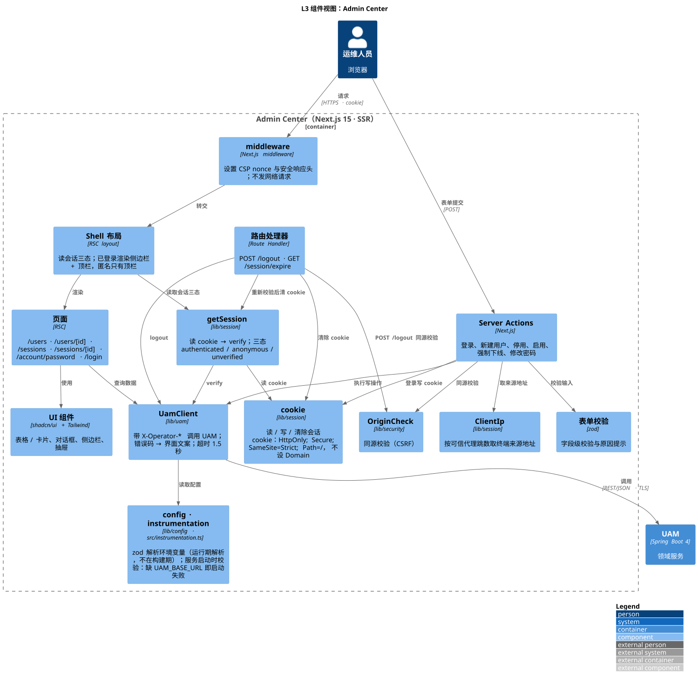

# Implementation Plan（Admin Center）: Admin Center 用户管理与会话管理

> **过程记录（Admin Center）**：原文为 `specs/002-admin-center-uam/plan.md`，归档时按 app 拆为 [system](../system/plan.md)（跨服务）、[uam](../uam/plan.md)、[admin-center](./plan.md) 三份。当前真实状态以各目录的 `README.md` 与代码为准；偏差清单见 [traceability §9](../system/traceability.md)。

**Spec**: [spec.md](../../achieve-specs/admin-center/spec.md) | **系统级计划**: [../system/plan.md](../system/plan.md) | **界面原型**: [prototype/](./prototype/README.md)

## Design

PlantUML 源文件与 SVG 在 [`diagrams/`](./diagrams/)；改图后重新渲染：`java -jar plantuml.jar -tsvg -charset UTF-8 docs/system-design/*/diagrams/*.puml`。

### L3 组件

#### Admin Center（L3 组件）



源文件：[c4-l3-admin-center-component.puml](./diagrams/c4-l3-admin-center-component.puml)

| 组件 | 职责 |
|---|---|
| `middleware` | 设置 CSP nonce 与安全响应头；**不发网络请求** |
| Shell 布局 | 读会话三态；已登录渲染侧边栏 + 顶栏，匿名只有顶栏 |
| 页面（RSC） | 用户、会话、改密、登录页面；经 `UamClient` 取数据 |
| Server Actions · 路由处理器 | 全部写入口（登录、新建、停用、启用、强制下线、改密、退出、`/session/expire`）；先过同源校验与表单校验 |
| `getSession` | 读 cookie → `verify`；三态 `authenticated` / `anonymous` / `unverified` |
| `UamClient` | **唯一**调用 UAM 的出口：带服务密钥与操作人请求头，超时 1.5 秒，错误码映射到界面文案；`server-only` |
| `OriginCheck` · 表单校验（zod）· `ClientIp` · UI 组件 | 同源校验（CSRF）、字段级校验、按可信代理跳数取来源地址、shadcn/ui 组件 |
## Project Structure

### Source Code

```text
└── admin-center/                         # Next.js 15 App Router · 页面与会话识别（使用 src/ 目录）
    ├── AGENTS.md  CLAUDE.md  package.json  tsconfig.json  next.config.ts  .env.example
    ├── components.json                   # shadcn/ui 配置
    ├── jest.config.ts  jest.setup.ts  playwright.config.ts  eslint.config.mjs
    ├── src/
    │   ├── middleware.ts                 # 仅设置 CSP nonce 与安全响应头，不发网络请求
    │   ├── instrumentation.ts            # 服务启动时校验环境变量（缺 UAM_SERVICE_KEY 即启动失败）
    │   ├── app/
    │   │   ├── layout.tsx  globals.css  not-found.tsx  error.tsx
    │   │   ├── (shell)/                  # 带外壳的路由组：layout 读会话三态
    │   │   │   ├── layout.tsx  page.tsx  # / → /users
    │   │   │   ├── users/{page.tsx, new/{page,actions}.tsx, [userId]/{page,actions}.tsx}
    │   │   │   ├── sessions/{page.tsx, [userId]/{page,actions}.tsx}
    │   │   │   └── account/password/{page,actions}.tsx
    │   │   ├── (auth)/login/{page,actions}.tsx   # 极简外壳
    │   │   ├── logout/route.ts
    │   │   └── session/expire/route.ts
    │   ├── components/
    │   │   ├── ui/                       # shadcn/ui 复制进来的组件（覆盖率排除）
    │   │   ├── shell/                    # app-shell、app-header、app-sidebar、user-menu、breadcrumbs、nav-config
    │   │   ├── auth/                     # login-form、change-password-form
    │   │   ├── users/                    # user-list、user-search-box、user-detail、user-form、account-list、status-actions
    │   │   └── sessions/                 # online-user-list、session-list、terminate-dialog
    │   └── lib/                          # 服务端模块一律 `import "server-only"`
    │       ├── config.ts                 # 环境变量（zod 解析，缺失即启动失败）
    │       ├── uam/                      # client、types.generated（由 OpenAPI 生成）、errors
    │       ├── session/                  # get-session（三态）、cookie、client-ip
    │       ├── security/                 # origin-check
    │       └── validation/               # 表单 zod schema
    └── tests/
        ├── unit/  contract/  e2e/        # e2e：视口矩阵、登录、用户与会话管理、无障碍
        └── support/uam-stub.ts           # msw 桩，按 OpenAPI 校验请求与响应
```
