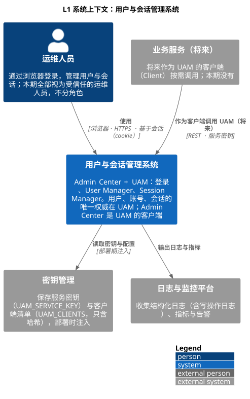
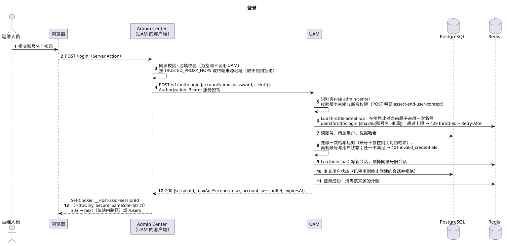
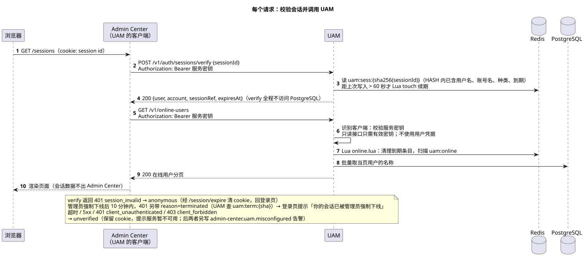
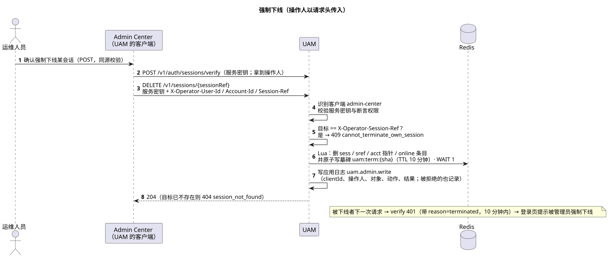

# Implementation Plan（系统级 / 跨服务）: Admin Center 用户管理与会话管理（User Manager / Session Manager）

> **过程记录（系统级 / 跨服务）**：原文为 `specs/002-admin-center-uam/plan.md`，归档时按 app 拆为 [system](./plan.md)（跨服务）、[uam](../uam/plan.md)、[admin-center](../admin-center/plan.md) 三份。当前真实状态以各目录的 `README.md` 与代码为准；偏差清单见 [traceability §9](../system/traceability.md)。

**Branch**: `feature/admin-and-uam`（规格原目录 `specs/002-admin-center-uam`，归档后见 [需求规格](../../achieve-specs/admin-center/spec.md)） | **Date**: 2026-10-23 | **Spec**: [spec.md](../../achieve-specs/admin-center/spec.md)

**Input**: Feature specification from `/specs/002-admin-center-uam/spec.md`（现位于 [achieve-specs](../../achieve-specs/admin-center/spec.md)）

## Summary

建立两个可独立横向扩展的服务，并在 Admin Center 里实现 User Manager 与 Session Manager：

- **Admin Center**（`apps/admin-center`）：接入层中的 **Web Server**（Next.js SSR）。登录成功后，浏览器对它的访问**基于会话**（cookie 里的 session id）。它**不存密码、不连数据库**，每个请求向 UAM 校验会话标识、拿到**会话数据**（用户、账号、会话引用），再把**操作人**作为请求头传给 UAM。
- **UAM**（`apps/uam`）：**RESTful 领域服务**（Spring Boot），用户、账号、会话的唯一权威。**对它的访问不基于用户会话**，不使用任何用户凭据（没有 JWT、cookie、会话标识）；**它只识别调用它的服务**：每个接口都先过**静态服务密钥**校验（每个客户端独立、可不停机轮换、带权限），网络边界只对客户端开放。接口路径按资源命名（`/v1/users`、`/v1/sessions`、`/v1/accounts/{id}/password` 等，不带客户端名）。

技术路线（详见 [research.md](./research.md)）：

- **无实例本地状态**：用户、账号、凭据在 PostgreSQL，会话在 Redis；任一实例处理任一请求，无需会话粘滞。
- **会话**：256 位随机标识（Redis 只存哈希）+ 非机密的会话引用；账号与会话一对一由 **Lua 脚本原子保证**；空闲 30 分钟 / 绝对 12 小时。
- **无 JWT**：UAM 不用用户凭据鉴权；`login` / `verify` 返回普通会话数据，Admin Center 把操作人（用户、账号、会话引用）作为 `X-Operator-*` 请求头传入，UAM 信任它并只用于自我保护规则与写操作日志；撤销只有浏览器路径一层，每请求 `verify`，会话结束后窗口为 0（R5、R6）。
- **服务密钥**（FR-042 ~ FR-044）：每个对 UAM 的调用都带静态服务密钥（`Authorization: Bearer`）；客户端清单放配置（名称、至多两个 SHA-256 哈希、权限），支持不停机轮换，由 `generate-service-key` 工具生成；只有带 `assert-end-user-context` 权限的客户端能代用户断言操作人（R4）。
- **写操作规则全部在 UAM**：新建（事务 + 唯一索引 + 幂等键）、停用 / 启用（咨询锁串行化 + 登录后复查状态）、强制下线（按会话引用）、改密；每次写操作写一条结构化应用日志（R15、R16）。
- **契约先行**：UAM 用 OpenAPI 3.1（[contracts/uam/openapi.yaml](../../../contracts/uam/openapi.yaml)），Admin Center 的路由、cookie 与错误文案见 [contracts/web-routes.md](../admin-center/web-routes.md)。
- **界面设计原型**（spec FR-041）已随本计划交付：[prototype/](../admin-center/prototype/README.md)，**须经你确认后才开始界面实现**。

> **待你确认的一项决定**：spec 没有指定技术栈，本计划沿用本仓库既有路线（UAM：Java 21 + Spring Boot 4；Admin Center：Next.js 15 + shadcn/ui；PostgreSQL + Redis），理由与替代方案见 research R2。若要换栈，请在进入 `/speckit-tasks` 前告知。

## Technical Context

**Language/Version**: UAM：Java 21（Spring Boot 4.0.x）；Admin Center：TypeScript 5、Node.js LTS（Next.js 15、React 19）

**Primary Dependencies**: UAM：Spring Boot 4（Web MVC、Validation、JDBC、Actuator）、spring-security-crypto + BouncyCastle（Argon2id）、Flyway 社区版、Lettuce、Micrometer。Admin Center：Next.js 15、React 19、Tailwind CSS 4、shadcn/ui（Radix UI）、zod

**Storage**: PostgreSQL 16（用户、账号、凭据）；Redis 7（会话、限流计数、幂等键）；Admin Center 无存储

**Testing**: UAM：JUnit 5、AssertJ、Mockito、Spring Boot Test + Testcontainers（PostgreSQL、Redis）、基于 OpenAPI 的契约测试、ArchUnit、并发测试、日志脱敏测试、JaCoCo。Admin Center：Jest + React Testing Library、msw（按 OpenAPI 校验的 UAM 桩）、Playwright（E2E 与视口矩阵）、`@axe-core/playwright`。扩展与弹性：k6

**Target Platform**: Linux 容器；两服务都无状态、可多实例部署；仅在内网 / VPN 内可达（部署配置保证）

**Project Type**: 双服务（Web Server × RESTful 领域服务）的单仓多应用

**Performance Goals**: 列表与详情页 95% ≤ 2 秒（10 万用户、1 万有效会话，SC-009）；1→4 实例吞吐 ≥ 3.2 倍（SC-011）；登录到看到用户列表 95% ≤ 30 秒含输入（SC-001）

**Constraints**: UAM 只对 Admin Center 实例开放，且每个接口都要过静态服务密钥校验（已确认，research R4、R23）；不使用任何用户凭据；会话结束后任一实例的下一次浏览器请求必判未登录（SC-013）；滚动重启 0 次意外登出（SC-012）；密码、哈希、会话标识不出现在页面、响应与日志（SC-014）；UAM 不可用时读提示「服务暂不可用」且不清 cookie、写提示「操作未生效」

**Scale/Scope**: 10 万用户、1 万同时有效会话；本期 8 个页面（登录、用户列表、新建用户、用户详情、在线用户、用户会话、修改密码，外加 `/` 重定向）；1 种账号（账号名 / 密码）；1 个客户端（`admin-center`，使用静态服务密钥）

## Constitution Check

*GATE: Must pass before Phase 0 research. Re-check after Phase 1 design.*

`.specify/memory/constitution.md` 仍是**未填写的模板**（未批准任何原则）。实际门禁取自根 [`AGENTS.md`](../../../AGENTS.md)；如需固化为 constitution，可另行运行 `/speckit-constitution`。

| 门禁（来源：根 AGENTS.md） | 结论 | 说明 |
|---|---|---|
| 范围与最小改动 | PASS | 只新增 `apps/*`、`contracts/`、`devops/`、`.github/workflows/`；不改既有文件 |
| 规格先于实现变更 | PASS | 本计划的两条 plan 级留白（撤销时效、客户端身份）在 research R4 / R6 解答，**不改变 spec 已确认的行为**，无需回写 spec |
| SOLID / YAGNI / KISS | PASS | 分层 `api → application → domain ← infrastructure`；明确不做 JWT / JWKS、mTLS 与 OAuth2 客户端凭据（后期按需）、Redis Cluster、会话标识轮换、react-hook-form、审计界面（YAGNI） |
| 契约优先 | PASS | OpenAPI 与 Web 路由契约先于实现；变更须先改契约与失败用例 |
| 安全与秘密 | PASS | 密钥不入仓（`.env.example` 仅占位）；日志统一脱敏；密码 Argon2id；会话标识与服务密钥只存哈希、不入日志；会话数据与操作人上下文不进 cookie / 浏览器 / 日志 |
| 测试先行（red → green → refactor） | PASS | research R20 定义各层测试，含并发测试；每个任务先提交失败用例 |
| 单元测试覆盖率 ≥ 90%（行覆盖率） | PASS（排除路径已列，终审在 PR 评审） | UAM：JaCoCo；Admin Center：Jest；口径与排除路径写入各自 `AGENTS.md` |
| 子项目须有 `AGENTS.md` 与 `CLAUDE.md` | PASS（任务中落实） | `apps/uam`、`apps/admin-center` 各建一对，含技术栈、命令、覆盖率与环境变量 |
| Quality gates（lint / typecheck / test / build） | PASS（任务中落实） | 各应用在 `AGENTS.md` 写明命令与 CI |
| 文档层级：完成后归档 | PASS（任务中落实） | 收尾任务把现状归档到 `docs/achieve-specs/` 与 `docs/system-design/` |

**Post-Phase-1 复核**：设计后重新核对，无新增违规；无需 Complexity Tracking。

## Design

采用 **C4 模型**：L1 系统上下文、L2 容器、L3 组件，并在 L3 里描述领域模型；关键流程用动态视图（时序图）补充。图用 **PlantUML**（C4-PlantUML 标准库）绘制，**源文件（`.puml`）与渲染好的 SVG 按 app 分放在各目录的 `diagrams/` 下（[system](./diagrams/)、[uam](../uam/diagrams/)、[admin-center](../admin-center/diagrams/)）**。GitHub 不渲染 PlantUML，所以 SVG 要和源文件一起提交；改图后重新渲染：

```bash
java -jar plantuml.jar -tsvg -charset UTF-8 docs/system-design/*/diagrams/*.puml
```

> 图已在归档时按 app 迁入各目录的 `diagrams/`（见 [系统级架构](./README.md)）；归档后以那里的图为准，本节保留为过程记录。

### L1 系统上下文



源文件：[c4-l1-context.puml](./diagrams/c4-l1-context.puml)

| 元素 | 类型 | 说明 |
|---|---|---|
| 运维人员 | 人 | 通过浏览器登录、管理用户与会话；本期全部视为受信任的运维人员，不分角色（spec Assumptions） |
| 用户与会话管理系统 | 本系统 | Admin Center + UAM；用户、账号、会话的唯一权威在 UAM；Admin Center 是 UAM 的客户端 |
| 业务服务（将来） | 外部系统 | 将来作为 UAM 的客户端按需调用，凭服务密钥识别；本期没有 |
| 密钥管理 | 外部系统 | 保存 `UAM_SERVICE_KEY` 与 `UAM_CLIENTS`（只含哈希），部署时注入 |
| 日志与监控平台 | 外部系统 | 收集结构化日志（含写操作日志）、指标与告警 |

### L2 容器


源文件：[c4-l2-container.puml](./diagrams/c4-l2-container.puml)

| 容器 | 技术 | 职责 | 状态与扩展 |
|---|---|---|---|
| 入口层 | nginx / 负载均衡 | TLS 终止；无粘滞轮询；设置可信代理头，供 Admin Center 取终端来源地址 | 无状态 |
| Admin Center | Next.js 15 · SSR | 登录页、User Manager、Session Manager；浏览器访问基于会话（cookie）；不存密码、不连数据库 | 无状态，多实例 |
| UAM | Spring Boot 4 · Java 21 | RESTful 领域服务：认证、会话、用户与账号；每个接口先校验服务密钥；不使用任何用户凭据 | 无状态，多实例；状态在下面两个存储里 |
| PostgreSQL 16 | 关系数据库 | 用户、账号、凭据（强一致） | 单主，按需主从 |
| Redis 7 | 内存数据库 | 会话、在线索引、登录与改密限流计数、幂等键 | 单主 + 高可用，不用 Cluster |

关键约定：

- 浏览器 → Admin Center：HTTPS，cookie 里只有机密的会话标识（`HttpOnly; Secure; SameSite=Strict`）。
- Admin Center → UAM：REST/JSON over TLS；每个请求带 `Authorization: Bearer <服务密钥>`；写操作与会话页另带 `X-Operator-*`（操作人）。UAM 不使用 cookie、会话标识或任何用户凭据来识别客户端。
- **网络边界**：UAM 只对 Admin Center 实例开放，PostgreSQL 与 Redis 只对 UAM 开放；与服务密钥一起是两层保护。
- 所有实例都无本地状态，任一实例可处理任一请求，负载均衡不需要会话粘滞。

### L3 组件

各服务的 L3 组件与领域模型见 [UAM plan](../uam/plan.md) 与 [Admin Center plan](../admin-center/plan.md)。

### 动态视图（关键流程）

**登录**（源文件：[seq-login.puml](./diagrams/seq-login.puml)）



**每个请求：校验会话并调用 UAM**（源文件：[seq-verify-and-call.puml](./diagrams/seq-verify-and-call.puml)）



**强制下线**（源文件：[seq-terminate-session.puml](./diagrams/seq-terminate-session.puml)）



### 设计要点与对 spec 的对应

| 设计要点 | 对应 |
|---|---|
| Admin Center 基于会话、UAM 不基于会话；会话标识只作为 `verify` / `logout` 的输入 | FR-008、FR-013 |
| UAM 不使用任何用户凭据（无 JWT）；操作人由客户端以请求头传入；会话数据不进 cookie / 浏览器 / 日志 | FR-007、FR-008、SC-014 |
| 撤销只有浏览器路径一层：每请求 `verify`，会话结束后窗口为 0 | FR-011、SC-013（research R6） |
| 每个接口先过静态服务密钥校验（客户端独立、可轮换、带断言权限），网络边界只对客户端开放 | FR-008、FR-042 ~ FR-044（research R4） |
| 账号与会话一对一由 Lua 原子保证；在线用户靠 `uam:online` 索引 | FR-004、FR-028 ~ FR-032（research R7、R9） |
| 仅管理员强制下线留下 10 分钟墓碑（只存会话标识哈希）；`verify` 的 401 `session_invalid` 据此带可选 `reason: terminated`，Admin Center 的 `/session/expire` 把它转成登录页的 `reason=session_terminated` 提示；其余结束方式保持通用提示 | FR-030、US6 |
| 停用：咨询锁 + 提交后终止会话 + 登录后复查状态 | FR-024、FR-025、SC-005 |
| 新建用户：事务 + 唯一索引 + `Idempotency-Key` | FR-021 ~ FR-023、SC-004 |
| 写操作应用日志（操作人、对象、动作、时间、结果） | FR-034、SC-014 |
| 无状态双服务、无会话粘滞、滚动重启不登出 | FR-037 ~ FR-040、SC-010 ~ SC-012 |
| 界面设计原型先于界面实现并经确认 | FR-041、SC-015 |
| L3 领域模型：User 聚合（PostgreSQL）与 Session 聚合（Redis）；一账号一会话、停用与自我保护规则都写在 domain 层 | FR-004、FR-016、FR-024、FR-025、FR-030 |

## Project Structure

### Documentation（归档后的位置）

```text
docs/achieve-specs/admin-center/          # 用户需求描述（不涉及技术细节，只收 spec.md）
└── spec.md
docs/system-design/                       # 架构与实现（设计侧，按 app 拆分）
├── system/              # 跨服务：C4 L1/L2、运行时与部署视图、跨服务安全、扩展性；plan.md、research.md（本文件所在）、quickstart.md、tasks.md、traceability.md（需求对照 / 验证记录 / 已知限制）、checklists/
├── uam/                 # UAM：L3 组件、领域、数据存储、安全；plan.md、research.md、data-model.md、domain-and-api.md（领域 / 接口 / 流程）
└── admin-center/        # Admin Center：L3 组件、安全；plan.md、research.md、web-routes.md（页面 / 路由 / cookie / 文案契约）、session-states.md（会话三态）、prototype/
contracts/uam/openapi.yaml                # UAM 契约唯一权威
```

### Source Code (repository root)

```text
apps/
  uam/            # 见 ../uam/plan.md
  admin-center/   # 见 ../admin-center/plan.md


contracts/uam/openapi.yaml                # 共享契约的唯一权威位置
devops/local/                              # docker-compose（PostgreSQL、Redis）、docker-compose.scale.yml（多实例）、nginx 无粘滞负载均衡、scripts/rolling-restart.sh
devops/load/k6/                            # 压测脚本（SC-009、SC-011）
.github/workflows/{uam,admin-center}.yml  # CI：lint、typecheck、test、覆盖率门禁、build
```

**Structure Decision**: 单仓多应用：`apps/uam` 与 `apps/admin-center` 各自独立构建、测试与部署，共享契约放仓库根 `contracts/`。UAM 按 `api → application → domain ← infrastructure` 分层，`domain` 不依赖框架；Admin Center 的服务端模块与浏览器包严格分离（`server-only`）。与未合并分支 `001-platform-web-uam` 同名的 `apps/uam` 目录冲突见 research §8。

## Complexity Tracking

无违规需要论证（Constitution Check 全部 PASS）。
