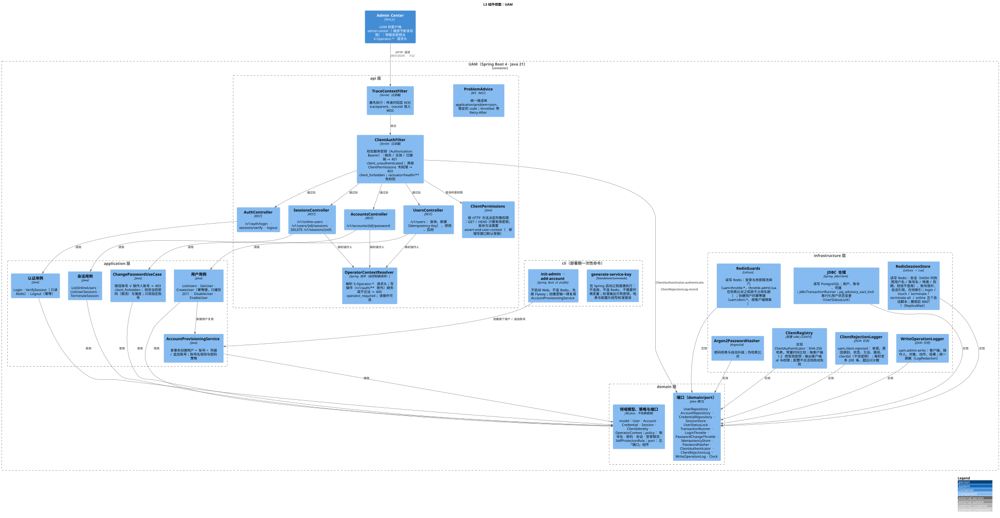
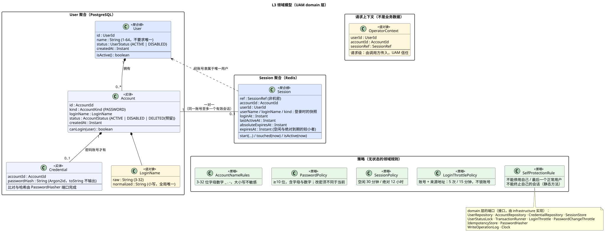
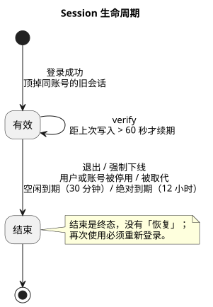

# UAM — 架构与实现（现状归档）

> **归档状态**：特性 `002-admin-center-uam` 已交付并归档。本文是**UAM（`apps/uam`）的架构与实现**的当前真实状态；需求规格见 [docs/achieve-specs/admin-center/spec.md](../../achieve-specs/admin-center/spec.md)；需求对照、验证记录与已知限制见 [traceability](../system/traceability.md)，UAM 领域与接口见 [domain-and-api](../uam/domain-and-api.md)。
> 设计按 app 拆分：[system](../system/README.md)（跨服务）· [uam](./README.md) · [admin-center](../admin-center/README.md)；各目录的 `plan.md`、`research.md`、`data-model.md` 是过程记录，与本文不一致时**以本文和代码为准**。
> 图的 PlantUML 源文件与 SVG 在各目录的 `diagrams/` 下；改图后重新渲染：`java -jar plantuml.jar -tsvg -charset UTF-8 docs/system-design/*/diagrams/*.puml`（GitHub 不渲染 PlantUML，SVG 须与源文件一同提交）。

跨服务的视图（C4 L1/L2、运行时与部署、来源地址信任模型）见 [系统级架构](../system/README.md)。

## 1. 总览

| 服务 | 路径 | 技术 | 状态 |
|---|---|---|---|
| UAM | `apps/uam` | Java 21、Spring Boot 4.0.x（Web MVC、Validation、JDBC、Data Redis / Lettuce、Actuator、Flyway 社区版）、`spring-security-crypto` + BouncyCastle（Argon2id）、Micrometer | 无实例本地状态；状态在 PostgreSQL 与 Redis |
| PostgreSQL 16 | — | 用户、账号、凭据（强一致） | 单主 |
| Redis 7 | — | 会话、索引、限流计数、幂等键；AOF `everysec` | 单主，不使用 Cluster |
| 契约 | `contracts/uam/openapi.yaml` | OpenAPI 3.1，错误体 RFC 9457 `problem+json` | UAM 契约唯一权威 |

## 2. 组件与领域

### 2.1 L3 组件

分层 `api → application → domain ← infrastructure`（依赖倒置；`domain` 不依赖任何框架；ArchUnit 的 `ArchitectureTest` 守住）。源文件：[c4-l3-uam-component.puml](./diagrams/c4-l3-uam-component.puml)。根包 `com.s2u2m.uam`：

| 层 | 组件 | 职责 |
|---|---|---|
| api | `TraceContextFilter` | 最先执行：传递并回显 W3C `traceparent`，trace id 放入 MDC |
| api | `OperatorContextResolver` | 由控制器调用（不是拦截器）：解析 `X-Operator-*`，写操作（`/v1/auth/**` 除外）缺失或非法 → 400 `operator_required` |
| api | `AuthController` · `UsersController` · `SessionsController` · `AccountsController` · `ProblemAdvice` | 协议转换与统一错误体；不含业务规则。错误码与状态码一一对应：`validation_failed` 一律 422（含请求体 Bean Validation 失败），无法解析 / 类型不符的请求 400 `bad_request`（不回显请求值） |
| application | `LoginUseCase` · `VerifySessionUseCase` · `LogoutUseCase` · `ListUsers` / `GetUser` / `CreateUser` / `DisableUser` / `EnableUser` · `ListOnlineUsers` · `ListUserSessions` · `TerminateSession` · `ChangePassword` · `AccountProvisioningService` | 编排领域对象与端口；事务边界；写操作日志。`AccountProvisioningService`（创建用户 / 追加账号）被「新建用户」用例与部署期命令共用 |
| domain | `model`、`policy`、`port` | 领域模型与规则；端口：`UserRepository` · `AccountRepository` · `CredentialRepository` · `SessionStore` · `UserStatusLock` · `TransactionRunner` · `LoginThrottle` · `PasswordChangeThrottle` · `IdempotencyStore` · `PasswordHasher` · `WriteOperationLog` · `Clock` |
| infrastructure | JDBC 仓储（`JdbcUserRepository`、`JdbcAccountRepository`、`JdbcCredentialRepository`、`JdbcTransactionRunner`） | 实现仓储、`UserStatusLock`（`pg_advisory_xact_lock`）、`TransactionRunner` |
| infrastructure | `RedisSessionStore`（+ `ReplicaWait`） | `SessionStore`：Lua 原子脚本；撤销后 `WAIT 1` |
| infrastructure | `RedisGuards` | `LoginThrottle` · `PasswordChangeThrottle` · `IdempotencyStore` |
| infrastructure | `Argon2PasswordHasher` · `WriteOperationLogger` · `SystemClock` | `PasswordHasher` · 写操作日志（`LogRedaction` 脱敏）· `Clock` |
| infrastructure/config | `PolicyConfig` · `RedisConfig` | 纯装配（覆盖率排除，见 §7） |
| cli | `InitAdminCommand` · `AddAccountCommand`（`cli` profile） | 部署期一次性命令，不是运维入口 |

### 2.2 领域模型

 

源文件：[domain-class.puml](./diagrams/domain-class.puml) · [domain-state-user.puml](./diagrams/domain-state-user.puml) · [domain-state-session.puml](./diagrams/domain-state-session.puml)。不变量与策略见 [domain-and-api §3](./domain-and-api.md)。User 聚合在 PostgreSQL，Session 聚合在 Redis，二者之间**无外键**，一致性靠用例保证。

## 3. 数据存储

### 3.1 PostgreSQL（`apps/uam/src/main/resources/db/migration/V1__init.sql`，Flyway 只前进）

| 表 | 列与约束 |
|---|---|
| `app_user` | `id uuid` PK；`name varchar(64)`，`CHECK (char_length(btrim(name)) BETWEEN 1 AND 64)`（**不要求唯一**）；`status text` `CHECK IN ('ACTIVE','DISABLED')`；`created_at timestamptz` 默认 `now()`；`updated_at timestamptz`（无默认值，由仓储在每次插入 / 更新时显式设置）。索引：`name` 上 `pg_trgm` GIN；`status` 普通索引 |
| `account` | `id uuid` PK；`user_id` FK → `app_user.id`；`kind text` `CHECK IN ('PASSWORD')`；`login_name varchar(32)`（创建后不可改）；`login_name_norm varchar(32)`，`CHECK (login_name_norm = lower(login_name))`；`status text` `CHECK IN ('ACTIVE','DISABLED','DELETED')`（`DELETED` 预留，本期无接口写入）；`created_at`。索引：`user_id`；**`login_name_norm` 全局唯一**（含已停用用户的账号）；`login_name_norm` 上 `pg_trgm` GIN |
| `credential` | `account_id uuid` PK，FK → `account.id`；`password_hash text`（Argon2id，`DelegatingPasswordEncoder` 格式）；`updated_at`（显式设置） |

扩展 `pg_trgm`；搜索（用户名或账号名，大小写不敏感、包含匹配）用 `ILIKE '%q%'` 走 GIN；`accountCount` 用 `account(user_id)` 索引聚合；分页 `limit/offset`。

### 3.2 Redis 键（均带 `uam:` 前缀）

会话类键的 TTL 取「空闲剩余」与「绝对剩余」的较小值（即会话有效到期）；**会话标识明文从不入库**，只存 SHA-256。

| 键 | 类型 | 内容 |
|---|---|---|
| `uam:sess:{sha}` | HASH | `ref`、`accountId`、`userId`、`userName`、`loginName`、`kind`、`loginAt`、`lastActiveAt`、`absExpiresAt`、`expiresAt`（毫秒时间戳）；`{sha}` = SHA-256(会话标识)；`verify` 的查找键，**用户名 / 账号名 / 种类是登录时的快照，使校验不查库** |
| `uam:acct:{accountId}:sess` | STRING | 当前有效会话的 `{sha}`（一对一指针） |
| `uam:sref:{ref}` | STRING | 会话引用 → `{sha}` |
| `uam:term:{sha}` | STRING | 强制下线墓碑：常量值，TTL = `uam.session.terminated-notice-ttl`（默认 10 分钟）；**仅管理员强制下线**在 `terminate.lua` 里与删会话原子写入；`verify` 在会话不存在时按所呈现标识的哈希查它，命中则 401 `session_invalid` 带 `reason: terminated`；退出、停用、被取代、到期都不写；键只含哈希 |
| `uam:online` | ZSET | 成员 `{userId}\|{ref}`，分数 = 有效到期（epoch 秒） |
| `uam:throttle:login:{sha256(规范化账号名\|来源地址)}` | STRING 计数 | 限流闸门的尝试计数（哈希比对之前 `INCR`，成功登录后删除）；首次设窗口 TTL，计数达到上限（默认 5）时 TTL 重置为封锁时长（15 分钟），超限后不刷新 |
| `uam:throttle:pwchg:{sha256(accountId\|来源地址)}` | STRING 计数 | 改密限流闸门的尝试计数；口径同登录，当前密码验证通过后删除 |
| `uam:idem:{sha256(键)}` | STRING | 进行中 `P\|指纹`（TTL 30 秒）或完成 `D\|指纹\|响应快照`（TTL 10 分钟）；`SET NX` 抢占；**只缓存 201**；指纹与快照不含密码 / 哈希；原始键不进键名 |

### 3.3 Lua 脚本（`apps/uam/src/main/resources/redis/`）

| 脚本 | 用途 | 说明 |
|---|---|---|
| `login.lua` | 登录 | 一次完成「读 `acct` 指针 → 删旧会话的 `sess` / `sref` / `online` → 写新 `sess`（HASH）、`acct`、`sref`、`online`」；返回被顶掉的旧会话引用。这是「一账号一会话」不变量的唯一保证 |
| `touch.lua` | 续期 | 会话仍存在才写（不重建）；`ARGV` 的 `lastActiveAt` 不晚于已存值则不写（返回 2）；一起刷新三个键的 TTL（`acct` / `sref` 仅在仍指向该会话时）并更新 `online` 分数 |
| `terminate.lua` | 按会话引用终止 | 清 `sess` / `sref` / `acct`（仅仍指向该会话时）/ `online`；返回 1 已终止、0 本来不存在。可选 `ARGV`（标记 + TTL 秒）：仅管理员强制下线传入，同一脚本里 `SET uam:term:{sha} 1 EX <TTL>`；退出与登录回滚不传 |
| `terminate-all.lua` | 按账号终止（停用用户） | 经各账号 `acct` 指针一次清四处；返回实际终止数 |
| `online.lua` | 在线用户索引 | `ZREMRANGEBYSCORE -inf now` 清理，再对**整个 `uam:online`** 逐成员 `GET uam:sref:*` + `HMGET uam:sess:*`，仅返回仍有效者；**已知规模上限见 §5.1** |
| `throttle-admit.lua` | 登录 / 改密限流闸门 | 在**哈希比对之前**原子占用一次名额：`INCR`；键刚建立（或意外无 TTL）时设窗口 TTL；计数恰好达到上限时把 TTL 重置为封锁时长；计数超过上限则拒绝（不刷新 TTL），返回剩余毫秒（`Retry-After`），否则返回 0。并发的 N 个错误尝试不会同时通过闸门 |

撤销类写入（`terminateByRef`、`terminateAllForUser`）之后调用 `ReplicaWait`：`WAIT 1 200ms`（至多等一个副本确认；单主无副本时立即返回 0）。登录时顶掉旧会话**不** WAIT。接受的残余风险：Redis 主从切换瞬间，最后约 1 秒内尚未复制的撤销可能丢失。

## 4. 安全设计

| 主题 | 设计与实现 |
|---|---|
| **调用方认证** | **目前没有**：UAM 不校验任何服务凭据，不识别调用方，所有接口（含 `/actuator/prometheus`）只靠网络隔离保护——k8s NetworkPolicy / 内网只放行 Admin Center。服务身份（服务间认证）留待后续特性实现，到时在 api 层加入认证过滤器与权限决策。**因此不得把 UAM 暴露到不受信任的网络。** |
| **操作人上下文** | `X-Operator-*` 由调用方传入、UAM **信任**，仅用于自我保护、`current` 标注与日志，**不用于认证或授权**。写操作缺失 / 非法 → 400；`/v1/auth/**` 除外。改密只允许改操作人自己的账号（路径账号 ≠ 操作人账号 → 403 `operator_forbidden`）。这意味着：能到达 UAM 的调用方可填任意操作人——在服务身份落地前，网络隔离须与数据库密码同级保管，UAM 只在受信任的内网可达。 |
| **会话** | 256 位随机标识；Redis 只存 SHA-256；对外只用 UUID 会话引用；会话数据不进 cookie / 浏览器 / 日志；不使用 JWT；每个浏览器请求 `verify`，撤销窗口为 0。 |
| **登录防枚举 / 防撞库** | 账号不存在 / 密码错误 / 账号停用 / 用户停用统一 `invalid_credentials`，且都先做 Argon2 比对（`LoginTimingIT` 统计性验证耗时无可区分差别）；按「账号 + 来源」在比对之前原子占用名额（前 5 次放行、第 6 次起 429，封锁 15 分钟，不锁账号）。 |
| **日志脱敏** | `LogRedaction` 两道防线：按键名（`password`、`currentPassword`、`newPassword`、`passwordHash`、`sessionId`、`serviceKey`、`authorization`、`token`、`secret`）整体遮蔽；按内容识别密码哈希（`{id}$…`、`$argon2…`）、`sha256:<64 hex>`、`uamk_…`、`Bearer …`、`key=value` 形式的机密与 ≥ 43 位的不透明令牌。 |
| **来源地址** | 见 [系统级 §4.3](../system/README.md)。 |

## 5. 扩展性与一致性

### 5.1 已知规模上限：在线用户列表

`online.lua` 在**一次** Redis Lua 调用里对整个 `uam:online` 做 O(N) 扫描：约 1 万会话时每次约 22 ms，Redis 单线程执行命令，期间不处理任何其他请求（包括所有实例的 `verify`）；理论上限约 45 次 / 秒的在线用户列表请求，**与 UAM 实例数无关**（加实例无效），且随会话数线性变差。实测 45 次 / 秒时 14.3% 页面触发 1.5 秒超时并拖累用户详情。**提议的最小修复（未实施，待用户确认）**：让脚本只读 `uam:online` 的分数（`ZRANGEBYSCORE`），由分数推出最近活动时间，不再逐成员读会话键；需先补「ZSET 与会话键不一致时的行为」测试，并确认由分数推导的 `lastActiveAt` 与现有契约一致。超过 10 倍规模时改为按用户分片的 ZSET。

### 5.2 一致性取舍

- 停用 / 登录并发：停用在咨询锁内置 `DISABLED`，**提交后**才终止会话；登录写入会话后**再读**用户状态——两种交错都不会留下已停用用户的有效会话（`DisableVsLoginRaceIT`）。
- 「最后一个正常用户」：`countActive()` 在咨询锁内读取，并发下始终至少留一个（`ConcurrentDisableIT`）。
- 账号名唯一：数据库唯一索引兜底；新建靠 `Idempotency-Key` 防双击与重试。
- Redis 单主 + `WAIT 1`：只缩小主从切换丢失撤销的窗口；本仓库的测试环境没有副本，`WAIT 1` 带副本的行为**未测试**。
- SC-011（吞吐线性）**未测量**。

## 6. 可观测性

| 项 | 实现 |
|---|---|
| UAM 日志 | 结构化 JSON（Spring `StructuredLogEncoder`，logstash 格式）输出到标准输出；`traceId`（来自 MDC）与事件键值对为顶层字段；`cli` profile 写标准错误（标准输出留给命令结果）。时间：事件的 `ts` 为 UTC（带 `Z`），`@timestamp` 跟随 JVM 时区 |
| 事件 `uam.admin.write` | 每次写操作（`user.create` / `user.disable` / `user.enable` / `session.terminate` / `account.password.change`）一条；字段 `ts`、`operatorUserId`、`operatorAccountId`、`action`、`targetType`、`targetId`、`outcome`（`success` / `rejected` / `failed`）、`reason`、`traceId`；被拒绝的也记录；`failed` 为 WARN，其余 INFO。退出不属于写操作，不写此事件 |
| 指标 | UAM：Micrometer，`/actuator/prometheus`（不校验调用方，靠网络隔离），统一 tag `application=uam`；多实例验证用各实例的 `http_server_requests`。Admin Center **没有**专门的指标端点 |
| 探针 | UAM：`/actuator/health/liveness`、`/actuator/health/readiness`（含 `readinessState`、`db`、`redis`；免校验，只暴露 UP / DOWN）。Admin Center 没有专用探针端点，编排用 `GET /login` 探活（匿名不调用 UAM） |

## 7. CI 与质量门禁

（`apps/uam`，`.github/workflows/uam-ci.yml`；命令以 [`apps/uam/AGENTS.md`](../../../apps/uam/AGENTS.md) 为准）

| 项 | UAM（`apps/uam`，`.github/workflows/uam-ci.yml`） |
|---|---|
| lint | `spotless:check`（google-java-format） |
| typecheck | `-DskipTests compile` |
| 测试 | 单元（`*Test`）+ 集成 / 契约 / 并发（`*IT`，Testcontainers 的真实 PostgreSQL 16 与 Redis 7，需要 Docker）；契约测试按 `contracts/uam/openapi.yaml` 校验；ArchUnit 守分层 |
| 覆盖率门禁 | JaCoCo **行覆盖率 ≥ 90%**（`jacoco.line.minimum`，作用于整个 BUNDLE，单元与集成合并统计）；`mvn verify` 低于阈值失败 |
| 排除路径 | `**/UamApplication.class`（启动类）、`**/config/*Config.class`（纯装配：`PolicyConfig`、`RedisConfig`）、`**/generated/**`（预留，目前无匹配） |
| build | `mvn verify` 打包 `target/uam.jar` |

## 8. 容器镜像

`apps/uam/Dockerfile`：Maven 打包 → `eclipse-temurin:21-jre`，非 root（uid 10001），`CMD ["java","-jar","/app/uam.jar"]`（用 CMD 以便部署期命令整条替换，`SPRING_PROFILES_ACTIVE=cli`）。

## 9. 相关文档

- 过程记录：[plan.md](./plan.md)、[research.md](./research.md)、[data-model.md](./data-model.md)。
- 需求对照、验证记录、已知限制：[traceability.md](../system/traceability.md)。
