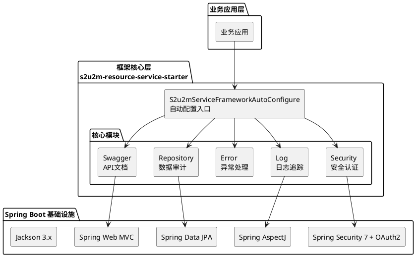
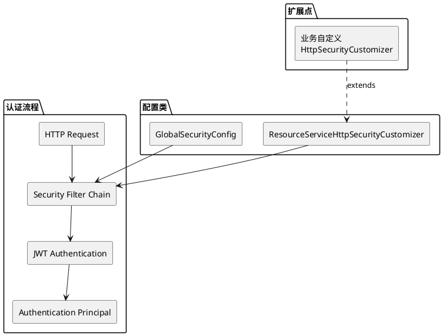
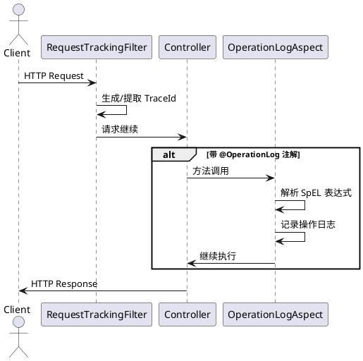
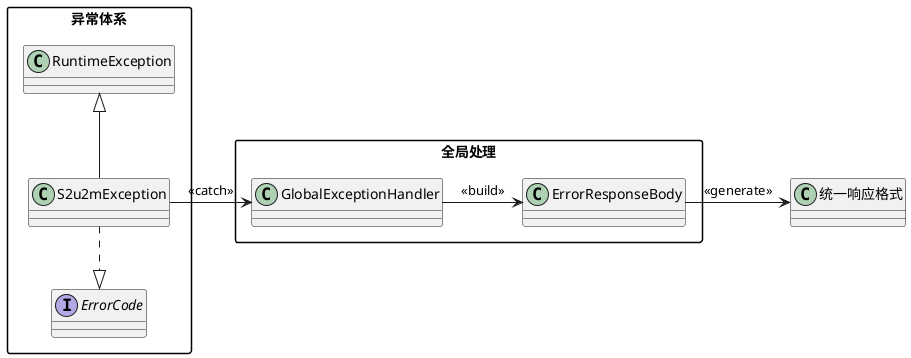
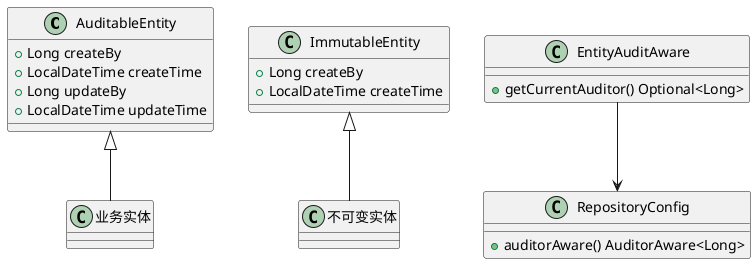
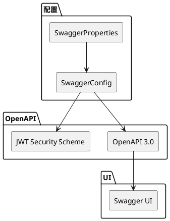
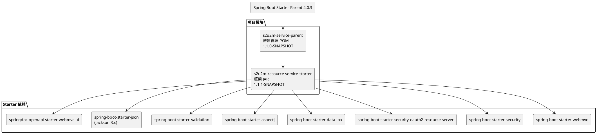
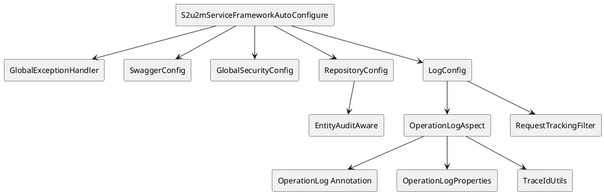
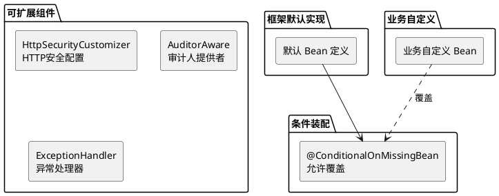

# S2U2M Service Framework 架构文档

## 项目概述

S2U2M Service Framework 是一个基于 Spring Boot 4.x 的企业级服务框架 Starter，提供开箱即用的安全认证、日志追踪、异常处理、API文档等核心能力。

---

## 一、技术栈

### 1.1 基础技术

| 技术 | 版本 | 说明 |
|------|------|------|
| **Java** | 17 | LTS 版本 |
| **Spring Boot** | 4.0.3 | 核心框架 |
| **Maven** | - | 构建工具 |

### 1.2 核心依赖

| 依赖 | 版本 | 用途 |
|------|------|------|
| `spring-boot-starter-webmvc` | 4.0.3 | Web MVC |
| `spring-boot-starter-security` | 7.x | 安全框架 |
| `spring-boot-starter-security-oauth2-resource-server` | 7.x | OAuth2 JWT 认证 |
| `spring-boot-starter-data-jpa` | 4.x | ORM 持久化 |
| `spring-boot-starter-aspectj` | 4.x | AOP 切面编程 |
| `spring-boot-starter-validation` | 4.x | 参数校验 |
| `spring-boot-starter-json` | 4.0.3 | JSON 序列化 (Jackson 3.x) |
| `springdoc-openapi-starter-webmvc-ui` | 2.8.5 | API 文档 |
| `nimbus-jose-jwt` | 10.4.2 | JOSE + JWT 处理 |
| `lombok` | - | 代码简化 |

### 1.3 模块结构

```
sb3-jdk17/
├── s2u2m-service-parent/              # 父 POM - 依赖版本管理 (1.1.0-SNAPSHOT)
│
├── s2u2m-resource-service-starter/    # 核心框架 Starter (1.1.1-SNAPSHOT)
│   └── src/main/java/com/s2u2m/services/core/
│       ├── S2u2mServiceFrameworkAutoConfigure.java
│       ├── error/                     # 异常处理
│       ├── log/                       # 日志追踪
│       ├── repository/                # 数据审计
│       ├── security/                  # 安全认证
│       └── swagger/                   # API 文档
│
└── examples/                          # 示例项目
    └── service-example-h2/            # H2 数据库示例
```

---

## 二、架构设计

### 2.1 整体架构



### 2.2 模块职责

| 模块 | 包路径 | 职责 |
|------|--------|------|
| **security** | `com.s2u2m.services.core.security` | OAuth2 JWT 认证、HTTP 安全配置 |
| **log** | `com.s2u2m.services.core.log` | 操作日志 AOP、请求追踪、TraceId |
| **error** | `com.s2u2m.services.core.error` | 全局异常处理、统一错误响应 |
| **repository** | `com.s2u2m.services.core.repository` | JPA 审计、实体基类 |
| **swagger** | `com.s2u2m.services.core.swagger` | OpenAPI 配置、JWT 认证方案 |

---

## 三、核心模块详解

### 3.1 安全模块 (Security)



**核心类：**

| 类名 | 职责 |
|------|------|
| `GlobalSecurityConfig` | 启用 Web 安全、方法安全，配置 JWT 认证转换器 |
| `ResourceServiceHttpSecurityCustomizer` | HTTP 安全配置，定义放行路径 |

**特性：**
- 支持 OAuth2 Resource Server (JWT)
- 方法级安全控制 `@EnableMethodSecurity`
- 可通过继承 `ResourceServiceHttpSecurityCustomizer` 扩展

### 3.2 日志模块 (Log)



**核心类：**

| 类名 | 职责 |
|------|------|
| `OperationLog` | 操作日志注解，支持 SpEL 表达式 |
| `OperationLogAspect` | AOP 切面，拦截注解方法并记录日志 |
| `RequestTrackingFilter` | 请求追踪过滤器，生成 TraceId |
| `TraceIdUtils` | TraceId 工具类 |

**特性：**
- 声明式操作日志 `@OperationLog`
- 支持 SpEL 表达式提取方法参数
- 自动请求追踪 (TraceId)
- 敏感字段脱敏支持

### 3.3 异常处理模块 (Error)



**核心类：**

| 类名 | 职责 |
|------|------|
| `ErrorCode` | 错误码接口 |
| `S2u2mException` | 框架基础异常 |
| `GlobalExceptionHandler` | 全局异常处理器 |
| `ErrorResponseBody` | 统一错误响应体 |

**响应格式：**
```json
{
    "code": "ERROR_CODE",
    "message": "错误描述",
    "traceId": "请求追踪ID"
}
```

### 3.4 数据审计模块 (Repository)



**核心类：**

| 类名 | 职责 |
|------|------|
| `AuditableEntity` | 可审计实体基类 (创建+更新) |
| `ImmutableEntity` | 不可变实体基类 (仅创建) |
| `EntityAuditAware` | 审计人提供者 |
| `RepositoryConfig` | JPA 审计配置 |

**特性：**
- 自动填充创建/更新时间
- 自动填充操作人 ID
- 继承即可使用，减少样板代码

### 3.5 API 文档模块 (Swagger)



**核心类：**

| 类名 | 职责 |
|------|------|
| `SwaggerConfig` | OpenAPI 配置 |
| `SwaggerProperties` | Swagger 属性配置 |

**特性：**
- 自动生成 OpenAPI 3.0 文档
- 集成 JWT 认证方案
- 可配置 API 信息和分组

---

## 四、模块依赖关系

### 4.1 Maven 依赖



### 4.2 类依赖



---

## 五、设计模式

### 5.1 使用的设计模式

| 模式 | 应用位置 | 说明 |
|------|----------|------|
| **自动配置模式** | `S2u2mServiceFrameworkAutoConfigure` | Spring Boot Starter 自动装配 |
| **条件装配模式** | `@ConditionalOnMissingBean` | 允许业务覆盖默认实现 |
| **装饰器模式** | `ResourceServiceHttpSecurityCustomizer` | 可扩展的 HTTP 安全配置 |
| **AOP 模式** | `OperationLogAspect` | 声明式操作日志 |
| **策略模式** | `ErrorCode` 接口 | 统一错误码抽象 |
| **模板方法模式** | `ResourceServiceHttpSecurityCustomizer` | 子类可扩展特定逻辑 |
| **观察者模式** | JPA `@EntityListeners` | 实体变更审计 |
| **责任链模式** | `RequestTrackingFilter` | Servlet Filter 链 |

### 5.2 扩展机制



---

## 六、使用方式

### 6.1 引入依赖

```xml
<dependency>
    <groupId>com.s2u2m.tk</groupId>
    <artifactId>s2u2m-resource-service-starter</artifactId>
    <version>1.1.1-SNAPSHOT</version>
</dependency>
```

### 6.2 启用自动配置

框架通过 `S2u2mServiceFrameworkAutoConfigure` 自动装配，无需额外配置。

### 6.3 可覆盖的配置

| 配置项 | 说明 | 默认值 |
|--------|------|--------|
| `spring.security.oauth2.resourceserver.jwt.public-key-location` | JWT 公钥路径 | - |
| `s2u2m.swagger.title` | API 文档标题 | - |
| `s2u2m.swagger.description` | API 文档描述 | - |
| `s2u2m.operation-log.enabled` | 操作日志开关 | true |

---

## 七、关键文件索引

| 文件 | 路径 |
|------|------|
| 自动配置入口 | `s2u2m-resource-service-starter/.../S2u2mServiceFrameworkAutoConfigure.java` |
| 全局异常处理 | `s2u2m-resource-service-starter/.../error/GlobalExceptionHandler.java` |
| 安全配置 | `s2u2m-resource-service-starter/.../security/GlobalSecurityConfig.java` |
| 操作日志切面 | `s2u2m-resource-service-starter/.../log/OperationLogAspect.java` |
| 审计配置 | `s2u2m-resource-service-starter/.../repository/RepositoryConfig.java` |
| Swagger 配置 | `s2u2m-resource-service-starter/.../swagger/SwaggerConfig.java` |
| 父 POM | `s2u2m-service-parent/pom.xml` |
| Starter POM | `s2u2m-resource-service-starter/pom.xml` |

---

## 八、Spring Boot 4.0 迁移说明

### 8.1 主要变化

| 变化项 | Spring Boot 3.x | Spring Boot 4.x |
|--------|-----------------|-----------------|
| **Spring Boot** | 3.4.2 | 4.0.3 |
| **Spring Security** | 6.x | 7.x |
| **Jackson** | 2.x (com.fasterxml) | 3.x (tools.jackson) |
| **Web Starter** | spring-boot-starter-web | spring-boot-starter-webmvc |
| **AOP Starter** | spring-boot-starter-aop | spring-boot-starter-aspectj |
| **OAuth2 Starter** | spring-boot-starter-oauth2-resource-server | spring-boot-starter-security-oauth2-resource-server |

### 8.2 依赖变更

**新增依赖：**
- `spring-boot-starter-json` - Jackson 3.x 自动配置
- `spring-boot-starter-webmvc-test` - WebMvc 测试专用 starter（模块化测试）

**依赖坐标变更：**
- Jackson 3.x 使用新的 Maven 坐标 `tools.jackson.core:jackson-core`

### 8.3 版本更新

| 组件 | 旧版本 | 新版本 |
|------|--------|--------|
| s2u2m-service-parent | 1.0.1-SNAPSHOT | 1.1.0-SNAPSHOT |
| s2u2m-resource-service-starter | 1.0.1-SNAPSHOT | 1.1.1-SNAPSHOT |
| nimbus-jose-jwt | 9.40 | 10.4.2 |
